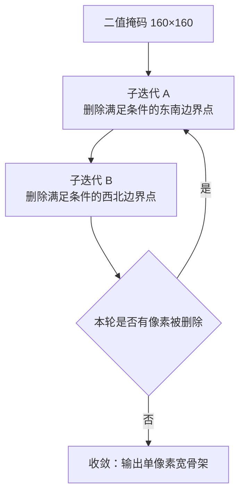

基础视觉分割模型的优化与落地到激光除草场景中的一些优化技巧进行说明

## 视觉分割模型

田间杂草常呈发散 / 星状形态，叶片空隙大。若仅用目标检测框，框中心易落在叶隙或土壤上，而激光必须打在植株内部。因此选用**实例分割**：用掩码支撑株心取点。分割模型采用**Ultralytics  YOLO11n-seg**，官方按 `n / s / m / l / x` 五档做宽度与深度缩放，车载边缘算力有限，本项目取最小的 `n` 档（约 **2.9 M 参数 / 10 GFLOPs**）以适配板端算力。

### 图像预处理

相机原始分辨率（2048×1536）与网络输入（640×640）的宽高比通常不同，若直接 resize，会把目标拉伸变形，使同一株草在训练与推理中呈现不同形状，直接损害精度。letterbox **先等比缩放、再用填充补齐**：既满足网络固定输入的尺寸要求，又不改变目标的几何比例。参考代码如下

```python
r = min(640 / h, 640 / w)
resized = cv2.resize(img, (w·r, h·r), INTER_LINEAR)
canvas  = 114 灰底，居中放入 resized
pad_x = (640 − w·r) // 2      pad_y = (640 − h·r) // 2
```

代码中 `r` 取两个方向缩放比的**最小值**，保证缩放后的长边恰好贴合 640、短边留出填充；用双线性插值对图像进行缩放，兼顾质量与速度；`canvas` 先以 **114（灰）** 铺满整幅，再把缩放图居中放入。`pad_x / pad_y` 分别是左右与上下的单侧填充宽度，由于取整，左右（或上下）各差 1 像素属正常现象。

填充值取 **114（灰）** 而不是纯黑或纯白，是与训练 / 推理默认保持一致的：模型在训练时见到的就是灰边，若推理时换成黑边（或反之），边界区域的响应会偏离训练分布，容易在图像边缘产生虚假检测。同理，插值方式也必须与训练一致。

### 模型结构

YOLO11 是 Ultralytics 于 2024 年 9 月发布的实时检测 / 分割框架，延续 YOLOv8 的 **anchor-free、单阶段、解耦头**范式，主要在「网络块」与「注意力」两处做了迭代：主干用 `C3k2` 取代 `C2f`，在保留跨层梯度通路的同时**减少参数量与访存量**（`k=2` 表示块内走两个小卷积核分支）；主干末端串联 `SPPF` 与 `C2PSA`，以很低的额外延迟引入全局建模；颈部仍是 FPN + PAN 双向融合，检测头继续使用分布化回归（DFL）与解耦分支，分割头则输出原型掩码与逐实例系数。


**Backbone** 输出**多尺度特征**：基本 block 为 `C3k2`（相对 YOLOv8 的 `C2f`，在相近感受野下算力更省），逐级下采样得到 **P3 / P4 / P5** 三个尺度（P3 / P4 / P5 是 Ultralytics 在 `yolo11.yaml` 里的特征图层级命名，在输入 640×640 下 P3 分辨率 80×80 检测小目标、P4 为 40×40 检测中目标、P5 为 20×20 检测大目标；结构定义见同目录 `yolo11.yaml` 与 `yolo11-seg.yaml`）；

末端经 `SPPF` 融合不同尺度感受野，再串联 **`C2PSA`**（带部分自注意力的位置敏感注意力模块），在不显著增加延迟的前提下增强全局特征建模；

**Neck** 采用 FPN + PAN 做跨尺度融合：骨干给出的 P3（分辨率高、定位细）与 P5（分辨率低、语义强）各有短板——幼苗这类小目标在 P5 上容易被下采样抹掉，成株这类大目标的语义在 P3 上又不足，因此需要自顶向下与自底向上两条路径「上传下达」。

**FPN（自顶向下）** 负责把深层语义送往高分辨率：P5 先经 `nn.Upsample`（nearest，2×）放大，再与骨干同尺度的 P4 按通道 `Concat` 拼接，由 `C3k2` 融合；融合结果继续 2× 上采样、与骨干 P3 拼接，同样经 `C3k2` 输出，得到送 P3 分支的融合特征。

**PAN（自底向上）** 负责把浅层定位再送回深层：上述 P3 融合特征经步长 2 的 `Conv` 下采样，与 FPN 路径同尺度的 P4 特征拼接后由 `C3k2` 融合，输出送 P4 分支的融合特征；再下采样一次并与 P5 侧特征拼接，经 `C3k2` 得到送 P5 分支的融合特征。

融合块用的是与骨干同代的 `C3k2`，使颈部的通道压缩与特征复用策略和骨干保持一致；三路融合特征最终交给 Head，其中 P3 那一路还负责生成后文 Head 中的 `proto`。

**Head** 在P3 / P4 / P5 三个尺度上各接一个检测分支，每个分支对网格上的每个候选位置（anchor point）输出**框、类与掩码系数**,分类与回归两分支分离。

回归分支采用 DFL（`reg_max=16`）对四条边的距离分布取期望，得到相对 anchor point 的四条边距离；

分割分支除逐实例的 `coeff（32）` 外，还由 P3 特征经一次 2× 上采样生成**单张共享**的 `proto（32×160×160）`，实例掩码由 `sigmoid(proto · coeff)` 得到。

三个尺度的候选在输出中首尾拼接为一条 `N = 80² + 40² + 20² = 8400` 的候选列表。

### 推理输出

Head 在三个尺度上输出框、类别与逐实例 `coeff`，另有一张共享的 `proto`。这些张量回传后，在后处理侧标准形态输出两个张量：

`out0 = [1, 4+nc+32, N]` 是拼接张量，依次为 box(4) + cls(nc) + mask_coeff(32)，其中 `N = 8400` 即 P3 / P4 / P5 三尺度候选的拼接

`out1 = [1, 32, H, W]` 是独立的 `proto`。

**（1）框解码。** 标准形态下 box 已是 `[cx, cy, w, h]` 绝对坐标，cls 也已是 sigmoid 概率，直接转 `xyxy` 即可，无需额外解码。

**（2）掩码解码。** 实例掩码由上一节 Head 的 `proto` 与 `coeff` 组合得到，这里的取舍不在于组合方式，而在于**在哪个分辨率上做这次组合与放大**。

**（3）坐标还原。** 后处理在 letterbox 后的 640 空间进行，最终按 `x_orig = (x_pad − pad_x) / scale` 还原到原图坐标，其中 `scale / pad_x / pad_y` 由预处理的 letterbox 给出。最终解码张量为 `(boxes, masks, scores, class_ids)`

### 损失函数

实例分割的训练目标由**框回归、分类、分布化回归、掩码**四项组成，按权重求和：

$$
L \;=\; 6.0\,L_{\mathrm{box}} \;+\; 0.5\,L_{\mathrm{cls}} \;+\; 1.5\,L_{\mathrm{dfl}} \;+\; 6.0\,L_{\mathrm{seg}}
$$

其中框回归项取 CIoU 损失、分类与掩码项取二元交叉熵、分布化回归项取分布交叉熵：

$$
L_{\mathrm{box}} = \frac{\sum_{i \in \Omega} w_i \left(1 - \mathrm{CIoU}(b_i, \hat{b}_i)\right)}{\sum_{i \in \Omega} w_i}, \qquad
L_{\mathrm{seg}} = \frac{1}{|\Omega|}\sum_{i \in \Omega} \frac{1}{A_i}\sum_{p \in \mathrm{crop}(m_i, b_i)} \mathrm{BCE}\left(\hat{m}_i(p),\, m_i(p)\right)
$$

式中 $\Omega$ 为正样本集合，$w_i$ 为任务对齐分配给出的软标签权重，$b_i / \hat{b}_i$ 为真值与预测框，$m_i / \hat{m}_i$ 为真值与预测掩码，$A_i$ 为第 $i$ 个目标的框面积，$\mathrm{crop}(\cdot)$ 表示只在真值框内取像素参与计算。

**（1）框回归。** 以 **CIoU** 度量预测框与真值框的差异，损失取 `1 − CIoU`。相比单纯 IoU，CIoU 额外惩罚中心点偏移与长宽比不一致，中心偏一点或框形被拉长都会被计分——这对打击点很重要：框的位置决定掩码的裁剪区域，框偏则掩码必然偏。权重取 `6.0`，与掩码同为最高一档。

**（2）分布化回归。** 框的四条边不直接回归为标量，而是预测成 `16` 个离散区间的概率分布，用交叉熵监督、取期望作为最终距离，即 **DFL**。好处是把「精确到亚像素的坐标」转化为「分布形状」，边界附近的量化误差被分布平滑掉，小目标的框更稳。权重取 `1.5`，起辅助约束作用。

**（3）分类。** 三类（杂草 / 作物 / 草）并非严格互斥，故用逐类独立的 **BCE**（sigmoid + 二元交叉熵）而非 softmax 交叉熵，允许同一个锚点对不同类别分别给出置信度，冲突留到后处理的跨类去重裁决。权重仅取 `0.5`：类别数少、正样本占比极低，权重过高会让分类项主导梯度，压制框与掩码的收敛。

**（4）掩码。** 实例掩码由 `32` 维系数与共享 `proto` 做 `einsum` 合成，再与该实例真值掩码逐像素算 **BCE**。关键在**只在真值框内裁剪后计算、并按框面积归一化**：不裁剪则背景像素远多于前景，损失被背景稀释、掩码边界学不锐；不按面积归一，大株的损失会盖过小株，小杂草的掩码质量先崩。掩码权重同样取 `6.0`，因为它直接决定骨架与打击点，是本场景的最终硬指标。

## 检测稳定性提升技巧

#### **定制 NMS处理**
标准 NMS 只有「同类、按 IoU 抑制」一条规则，直接套用到除草场景会在三处失效，因此在贪心 NMS 框架上做了三项定制。① **逐类抑制**：按类别分开、类内按置信度降序保留高分框，抑制与之 IoU 超阈的框——分类处理是必要的，否则同区域重叠的杂草与作物会互相压制；同时保留候选列序号，供随后按列取 `coeff` 解掩码。② **包含去重**：大框套小框时 IoU 只等于小框面积比大框面积（可低至 `0.11`），标准 NMS 抑制不掉，故改用**包含比例**判据，同类小框被覆盖超 `90%` 即删除；只在同类间做，避免作物大框误删其中的小杂草。③ **跨类去重**：高置信作物抑制与之重叠的杂草，低置信作物视为误检丢弃，两者都低置信时保留高分者；`weed ↔ grass` 语义重叠、互斥，保留高分者。贯穿三项的原则是宁多打一株草、不多打一株苗，因此跨类去重绝不会删掉高置信作物。

#### **双阈值滞回**
思路借鉴自 **Canny 边缘检测的双阈值判定**。Canny 中先用高阈筛出确定无疑的强边缘，再由低阈得到大量弱边缘作为候选，只有与强边缘连通的弱边缘才被提升为边缘、孤立的弱边缘直接丢弃——两个阈值之间因此存在一条「既非肯定、也非否定」的过渡带，带内的像素不靠自身强度决定去留，而靠上下文有没有确定结论。这种「同一输入因当前状态不同而输出不同」的特性即所谓**滞回**（hysteresis）：从无到有须跨过高阈，从有到无须跌破低阈，落在中间带内则维持原状态。

对应到检测结果上，置信度在阈值附近抖动时，同一株草会在「检出 / 丢失」之间反复横跳，表现为目标闪烁；若只用单一阈值，门槛调高就漏检、调低就误检，两头不可兼得。滞回的做法是**让「消失」比「出现」更难**：高阈决定「能否出现」，低阈决定「是否撤销」，中间带内不单独下结论，而是回查上一帧的存活结果——能匹配上历史目标就延续，匹配不上才删除，用「历史是否认同」替代 Canny 中「邻域是否连通」的判据。于是偶发的低分帧不会立刻让目标消失，只有持续走低并彻底失去历史关联时才撤销；新出现的弱响应也不会仅凭一次低分就凭空生成，从而同时抑制闪烁与误检。

两个阈值的间距即容忍度：带宽越大越稳，但目标真正消失后滞后也越久；本项目取 `0.5 / 0.35` 的窄带，在稳定性与响应及时性之间折中，带内的匹配判据取上一帧存活框的最大 IoU。

　　**高置信直接出现**：`score ≥ on_thresh`（`0.5`）→ 保留；

　　**滞回带内看历史**：`off_thresh ≤ score < on_thresh`（即 `0.35 ≤ score < 0.5`）且与上一帧存活框的最大 IoU ≥ `match_iou`（`0.3`）→ 保留；

　　**其余丢弃**：`score < 0.35`，或落在滞回带但没有匹配上上一帧的存活目标 → 丢弃。

上述技巧在原始模型输出之上做了**精修**，围绕激光除草「不漏打、不误打、不闪烁」的目标，从召回、精度、稳定性三个维度共同提升检测质量。


## 生长点几何计算

星状 / 细长株在检测框内只占一小部分，框中心常落在叶隙或土壤上，而激光必须打在植株内部，因此打击点一律从**掩码**求取，不取框中心。面积质心取掩码前景像素均值，速度最快但是选点并不理想


**骨架根部点**的**分叉点**对应主茎与枝叶交汇的「生长点」计算：先对掩码进行二值化，掩码以最近邻插值法缩到 **160×160**，再进行二值化处理，二值化过后就是细化处理。

细化采用**Zhang-Suen 细化算法**（Zhang-Suen thinning）：按 8 邻域模板判断前景像素能否删除，在「东南 / 西北」两个互补子迭代间交替削薄边界，直至一轮内无可删点为止。其中「满足条件」指前景邻居数落在有效区间、8 邻域连通分量恰为 1、且删除后既不抹掉端点也不产生新孔洞，故结果**拓扑等价**——只保留连通拓扑、不保留粗细。




选它而非距离场脊线，是因为它无需调参、只做局部模板判断、对任意形状都能收敛，实现与耗时都可控。


