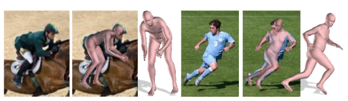

> Bogo, Kanazawa et al., *Keep it SMPL: Automatic Estimation of 3D Human Pose and Shape from a Single Image*, ECCV 2016.（代码基于 OpenDR + Chumpy，见文末附节）

**一句话**：把「单图估人体」写成一个**带先验的能量最小化**问题，用 SMPL 的强约束把病态问题压成可解优化。


## 先认记号

| 记号 | 含义 |
| :--- | :--- |
| $\beta$ | 体型系数（实验中固定 10 维） |
| $\theta$ | 姿态轴角，23 个关节的相对旋转（含根） |
| $J(\beta)$ | 由体型决定的关节位置（顶点的稀疏线性映射） |
| $R_{\theta}$ | 由姿态诱导的全局刚体变换 |
| $\Pi_{K}$ | 相机 $K$ 下的透视投影 |
| $J_{\text{est}}$ | CNN 检测到的 2D 关节 |
| $w_{i}$ | 第 $i$ 个关节的检测置信度 |
| $\rho$ | 鲁棒代价函数（Geman–McClure） |
| $\lambda_{\theta},\lambda_{a},\lambda_{sp},\lambda_{\beta}$ | 各项权重 |

## 流程：自下而上检测 + 自上而下拟合

```text
RGB 图像
  → CNN（DeepCut 等）估计 2D 关节 J_est
  → 相似三角形初始化深度；躯干关节估朝向与平移（β 固定均值）
  → 分阶段优化 β, θ（最小化 Eq.1 的五项能量）
  → 得到可对齐图像的 3D mesh
```

流程里的核心是**加权能量最小化**。记号与 SMPL 一致：网格 $M(\beta,\theta)$，关节 $J(\beta)$ 是顶点的稀疏线性映射，$R_{\theta}$ 是姿态诱导的刚体变换，$\Pi_{K}$ 是相机 $K$ 下的透视投影。总能量（原论文 Eq.1）：

$$
\begin{aligned}
E(\beta,\theta)=\;&E_{J}(\beta,\theta;K,J_{\text{est}})
+\lambda_{\theta}E_{\theta}(\theta)
+\lambda_{a}E_{a}(\theta)\\
&+\lambda_{sp}E_{sp}(\theta;\beta)
+\lambda_{\beta}E_{\beta}(\beta)
\end{aligned}
$$

| 项 | 名称 | 管什么 |
| :--- | :--- | :--- |
| $E_{J}$ | 关节重投影 | 让人「对得上图」 |
| $E_{\theta}$ | 姿态先验（8 分量 GMM） | 让姿态「像人」 |
| $E_{a}$ | 肘 / 膝超伸罚 | 禁反关节 |
| $E_{sp}$ | 互穿罚（capsule） | 禁身体自穿 |
| $E_{\beta}$ | 体型先验 | 压住体型乱飘 |

$\lambda_{\theta},\lambda_{a},\lambda_{sp},\lambda_{\beta}$ 是各项权重，论文只在 HumanEva 上调出一组后全程沿用，**未公布数值**。

## ① 关节重投影项（Eq.2）

$$
E_{J}(\beta,\theta;K,J_{\text{est}})
=\sum_{\text{joint }i}w_{i}\,
\rho\!\left(\Pi_{K}\!\left(R_{\theta}\!\left(J(\beta)_{i}\right)\right)-J_{\text{est},i}\right)
$$

- $w_{i}$：DeepCut 给的 2D 置信度。被遮挡的关节权重自然变低，话语权交给先验；
- $\rho$：**鲁棒代价**。原文只引用 Geman–McClure（Geman & McClure 1987）而没写解析式，常见形式是

$$
\rho_{\sigma}(e)=\frac{e^{2}}{\sigma^{2}+e^{2}}
$$

误差超过尺度 $\sigma$ 后梯度饱和，个别误检 / 遮挡关节不会主导整个优化 —— 这就是 SMPLify 对 2D 检测噪声有容忍度的原因。

## ② 姿态先验：高斯混合（Eq.4–5）

$$
E_{\theta}(\theta)=-\log\sum_{j=1}^{8}g_{j}\,\mathcal{N}\!\left(\theta;\mu_{\theta,j},\Sigma_{\theta,j}\right)
\;\approx\;\min_{j}\left(-\log\!\left(c\,g_{j}\,\mathcal{N}\!\left(\theta;\mu_{\theta,j},\Sigma_{\theta,j}\right)\right)\right)
$$

- $8$ 个高斯，由 MoSh 把 SMPL 拟合到 CMU mocap 得到（100 个 subject、约 100 万姿态）；
- 求和取 **max 近似**（Olson & Agarwal），化成「取最小能量模态」的 $\min$ 形式才好求导；
- 代价是模态切换点不可微，实现里用当前最低能量模态的 Jacobian 近似。

> 本质：单图的 2D 关节对 3D 位姿严重**欠定**（前后倾、左右手互换都能投影一致），先验负责补「常识」。

## ③ 肘 / 膝超伸罚（Eq.3）

$$
E_{a}(\theta)=\sum_{i}\exp(\theta_{i})
$$

$i$ 遍历膝、肘的弯曲角。不弯时 $\theta_{i}=0$；往反关节方向为正，**指数级重罚**，往自然弯曲方向为负、罚得轻 —— 用一个不对称函数表达「关节只能这么弯」。

## ④ 互穿惩罚（Eq.6）

$$
E_{sp}(\theta;\beta)=\sum_{i}\sum_{j\in I(i)}
\exp\!\left(\frac{\left\|C_{i}(\theta,\beta)-C_{j}(\theta,\beta)\right\|^{2}}
{\sigma_{i}^{2}(\beta)+\sigma_{j}^{2}(\beta)}\right),
\qquad \sigma(\beta)=\frac{r(\beta)}{3}
$$

- 人体近似成 **20 个 capsule**（每个部件一个，去掉手指脚趾），半径 $r$ 与轴长先用梯度优化拟合 SMPL 训练体型，再**从 $\beta$ 做 ridge 回归**预测；
- $C_{i}$：沿 capsule 轴心采样的球心；$I(i)$：与该球「自然姿态下不该相交」的球集合；
- 软约束，只惩罚不禁止；且**只对 $\theta$ 用、不对 $\beta$ 用** —— 否则优化会把体型压瘦来规避穿插。

## ⑤ 体型先验（Eq.7）

$$
E_{\beta}(\beta)=\beta^{\top}\Sigma_{\beta}^{-1}\beta
$$

$\Sigma_{\beta}^{-1}$ 为对角阵，元素取 SMPL 形状 PCA 的奇异值平方（即按主成分方差标准化）；$\beta$ 按构造零均值。

> **为什么必须有这一项**：2D 关节几乎无法辨识体型 —— 瘦高与矮胖可以投影到同一组 2D 点。论文明确说 shape is ambiguous given 2D joints，体型只能靠统计先验兜住。这也正是 HMR 后来必须补对抗先验的原因。

## 相机与初始化（Sec. 3.3）

- **焦距 $f$ 固定不优化**（与平移一起优化约束太少，会病态）；
- 深度初始化：假设人平行于像平面站立，用**相似三角形** —— 均值体型的躯干长度比预测的 2D 关节长度；
- 先在**躯干关节**上最小化 $E_{J}$ 细化平移与朝向，此时 $\beta$ 固定为均值体型；
- **侧向歧义**：两肩 2D 距离小于阈值（人侧对镜头）时，额外试一个「朝向转 180°」的初始化，取 $E_{J}$ 更小者。

## 求解

- **分阶段降权**：$\lambda_{\theta}$、$\lambda_{\beta}$ 先取大值再逐阶段减小，避免一上来被局部极小锁死；
- 求解器 **Powell's dogleg**，实现基于 **OpenDR + Chumpy**（自动微分）；
- 单图 **1 分钟以内**（桌面机）；
- 各项权重、阶段划分、迭代次数、$\rho$ 的 $\sigma$：**原文一律未给出**，要用只能翻官方代码。

这是经典的 **「检测 + 生成模型优化」**：SMPL 强约束把病态的单图 3D 问题压成可解优化。

## 附：OpenDR / Chumpy 到底是什么

> Loper & Black, *OpenDR: An Approximate Differentiable Renderer*, ECCV 2014, pp. 154–169.（同一个作者后来也写了 SMPL）

**它原本要解决的是逆图形（inverse graphics）**：从图像反推几何、光照、材质、运动。可渲染器只会算正向（参数 → 图像），要做反推就必须有「图像的像素关于参数的导数」。OpenDR 给 OpenGL 光栅化管线补上了这套导数，能对**相机（内外参、焦距）、几何（顶点坐标）、光照（方向 / 强度 / 环境光）、颜色与材质**反传。

**「近似」二字很关键**：光栅化里有可见性、遮挡、轮廓这类离散变化，严格讲不可导。OpenDR 不处理这些跳变，用局部解析近似给出梯度 —— 数值上不精确，但对优化够用，这也是它能跑起来的原因。

**SMPLify 只借了它的一半**（只优化关节、不渲染图像）：

| 组件 | 作用 | SMPLify 用没用 |
| :--- | :--- | :--- |
| OpenGL 渲染器 | 参数 → 图像，且可微 | 没用（不比像素，只比 2D 关节） |
| **Chumpy** | numpy 风格的可微数组：重载算子 + 计算图 + 反向自动微分 | **用了**，整套能量都靠它求导 |
| `ch.minimize` | 基于 Chumpy 的优化器（含信赖域方法） | **用了**，`method='dogleg'` |

所以「SMPLify 用 OpenDR」这句话准确的说法是：**用它的自动微分与优化内核，把「手推雅可比」这件事省掉**。能量只要写成标量，梯度就沿着计算图自动反传：

```python
import chumpy as ch

def energy(beta, theta):
    E  = ch.sum(w * gm(project(J(beta, theta)) - J_est))   # 重投影项，gm 即 Geman-McClure
    E += lam_theta * prior_theta(theta)                    # 姿态先验
    E += lam_beta  * prior_beta(beta)                      # 体型先验
    return E                                               # 一个标量，梯度自动可得

ch.minimize(energy, x0=[beta, theta], method='dogleg',
            options={'maxiter': 100, 'disp': True})
```

`dogleg` 是信赖域 Gauss–Newton 类方法，天然适配这种「鲁棒最小二乘」形状的能量：残差平方和 + 少量鲁棒核，Hessian 可用雅可比近似。

**为什么今天不用它了**：OpenDR / Chumpy 是 Python 2 时代的产物，依赖老版 numpy，在现代环境里基本装不动（SMPLify 官方代码要 Python 2.7 加补丁）。它的思想已被 PyTorch / JAX 的 autograd 完全覆盖 —— **同一套能量用 torch 写，`loss.backward()` 就相当于当年的求导部分**，还顺带得到 GPU 和更成熟的优化器。SMPL-X / SMPLify-X 已经整体迁到 PyTorch。

> 一句话记住：OpenDR 提供「可微 + 优化」的地基，SMPLify 在这块地基上只盖了「能量函数」这一层楼。

## 代价

单图要跑几十秒量级的非线性优化，难实时；依赖 2D 检测质量；衣物宽松时「衣服下的身体」更歧义。但它把「单图 → SMPL 参数」做成了可用基线，并留下大量可作伪标签的拟合结果。

前提假设也都是硬约束：**单人、性别已知、焦距固定、无遮挡推理、无地面接触约束**。其中「体型靠先验而非图像证据」这一点最关键 —— 能量函数里 $E_{\beta}$ 只负责「不要离谱」，并不负责「长得像本人」，所以 SMPLify 的体型输出本质是**先验下的最可能解，而非观测到的真值**。这也是后续工作（HMR 的对抗先验、SPIN 的回归 + 优化闭环）主要要补的洞。

## 往下读

- 上一篇：[SMPL 人体参数化模型](SMPL人体参数化.md)
- 下一篇：[HMR：端到端回归](HMR端到端回归.md) —— 把这里的优化「学」进网络

> **一句话记住**：SMPLify 的全部聪明才智，都在「2D 关节欠定，所以必须用先验把它约束住」这一句上。
