# 数字人衣物建模技术资料汇总

---

## 一、总体目标

数字衣物构建系统的最终设计目标：

让未受过服装设计和CG软件教育的普通用户（如服装店店员等）通过短期学习能够快速构建高精度写实的数字人衣物，降低此类数字资产的制作成本。

具体从以下几个方案着手

- 方案一: 基于深度学习单帧三维重建
- 方案二: 基于视觉的衣物分类索引
- 方案三: 通过对扫描模型进行模型分割

总体图

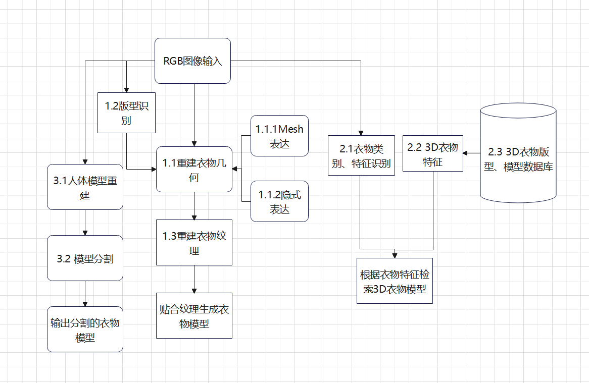

### 1.1 任务目标

从1衣物点云，2.RGB图像（有人或无人,视频） 其他任务：4.衣物动态的快速物理仿真  5.衣物模型的快速生成

### 1.2 难点

难点：衣物本身薄壳结构难以MVS重建，复杂形态，动态褶皱，样式众多

### 1.4 专业研究团队

专业研究团队： 1.上科 2.港中文 3.Style3D

---

## 二、技术背景

### 2.1 传统数字衣物建模

1.传统数字衣物建模

### 2.2 SMPL参数化方法

2.SMPL参数化方法

### 2.3 重建带衣物的人体模型（着重介绍《PIFU》）

3.重建带衣物的人体模型（着重介绍《PIFU》）

PIFU提出了一种逐像素

要进行人体重建必须要能够正确的提取出人体特征。人体特征一般分为体型和姿态。所以要能够正确提取出人体姿态，如PIFU

### 2.4 衣物点云（NeuralTailor）

4.衣物点云 (NeuralTailor)

### 2.5 衣物空间的学习

衣物空间的学习

GCN学习衣物网格特征，一般是使用VAE

《Cloth3D》

### 2.6 单帧重建的方法

单帧重建的方法：

---

## 三、算法谱系

### 3.1 总体思路

0.暴力求解 1.直接用CNN提取特征，PointNet等提取特征，通过GCN来糅合特征进行生成 2.DeepFashion3D通过定义“特征线”来降低这个求解难度

### 3.2 路线一：衣物点云

1.衣物点云 考虑只有衣物的点云 可以用PointNet，对衣物进行参数化《NeuralTailor》

### 3.3 路线二：RGB图像

2.RGB图像 目标是代替昂贵的三维扫描仪 RGB图像进行分类：1.单纯衣物专业图片 2.包含人体的自然图片 通过隐式重建方法《PIFU》等，或是进一步结合SMPL先验《ARCH》《Icon》《PAMIR》等 先导技术是：人体姿态检测

nerf效果有很好的重建效果 《HumanNerf》 但是如何从Nerf中将3D模型提取出来？

思路：对Nerf进行模型抽取

### 3.4 路线三：人体扫描模型与网格分割

人体扫描模型 网格分割（Mesh Segmentation）

《ClothCap》：通过MRF方法对扫描模型进行顶点分割抽取出其中衣物模型

《IPNet》(MPI_meshRegister,RVH_MeshRegister)通过扫描模型进行SMPL配准

其他网格分割方法：CoSeg等

### 3.5 路线四：动态仿真与快速生成

4.衣物动态的快速物理仿真 1.对于Tshirt等简单衣物，用PCA进行降维来学习即可 2.《TailorNet》

5.衣物模型的快速生成 1.用GCN学习衣物网格特征

---

## 四、方案一：基于深度学习单帧三维重建

### 4.1 概述

#### 4.1.1 重建衣物几何

版型是衣物模型

基于Mesh，现有研究有《BCNet》《MGN》等，基本上都是基于SMPL+D的方案，即将衣物模型视为人体模型的偏移，通过在SMPL标准姿态下添加顶点的偏移，然后再使用蒙皮变形得到目标姿态的穿衣人体几何。

由于基于Mesh的表达,对于模型拓扑有较强的限制，所以也有工作如《Simplicit》基于隐式表达

#### 4.1.2 借助版型作为先验

可以借助版型作为衣物模型的强大先验信息，从而更加高效进行建模,现有相关工作包括《NeuralTailor》输入点云输出版型（基于《Garment Database》提出的版型）

#### 4.1.3 表面纹理恢复

衣物模型表面纹理的恢复，可以考虑从RGB图像学习该衣物模型的纹理展开从而获得模型表面的纹理。这方面现有的工作要更少，现已知的仅有《Pix2Surf》方法

### 4.2 现有进展

1. 参考BCNet,实现了几何重建效果

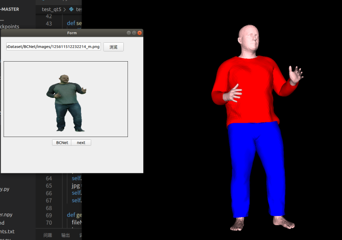

2. 基于Pix2Surf，实现了对于简单类别（T恤、男性长裤）的纹理重建效果

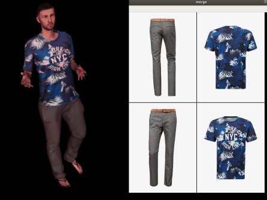

3. 基于《Garment Detabase》，实现了一套衣物版型参数化（19类简单衣物）工具（基于Maya）

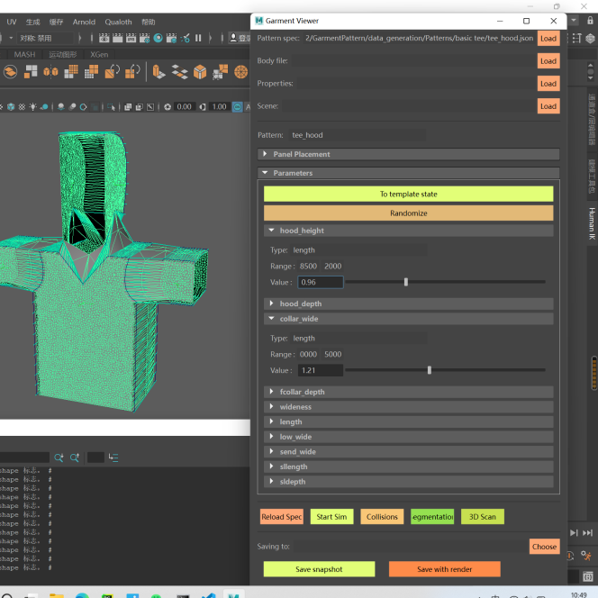

### 4.3 之后的开发计划

1. 将几何重建与纹理重建串起来，形成一个完整的流程
2. 研究根据RGB图像索引衣物版型的方法
3. 将版型参数化工具从Maya里独立出来，并丰富其功能，扩展为一个简易的服装CAD工具

---

## 五、方案二：基于视觉的衣物分类索引

### 5.1 概述

#### 5.1.1 二维图像的衣物特征提取

通过CNN方法获取到图像中衣物的特征，此类方法已经比较成熟能实现比较好的效果，开源的方案有《DeepFashion》等

#### 5.1.2 三维模型特征提取

3D模型的特征还没有统一的效果比较好的方法，而且3D模型数据难以获取，所以难有比较好的效果，现在已有的方法主要有GCN系列方法，以及对于点云的PointNet方法

#### 5.1.3 大型衣物模型数据库

获取是比较困难的，现有已知的公开数据集有《Cloth3D》《Garment Database》但是其衣物类型还是比较少的，如果此方案铺开，考虑尝试联系服装设计场获取此类数据

### 5.2 现有进展

1. 基于《DeepFashion》方法，实现了一套衣物类型识别和特征识别算法

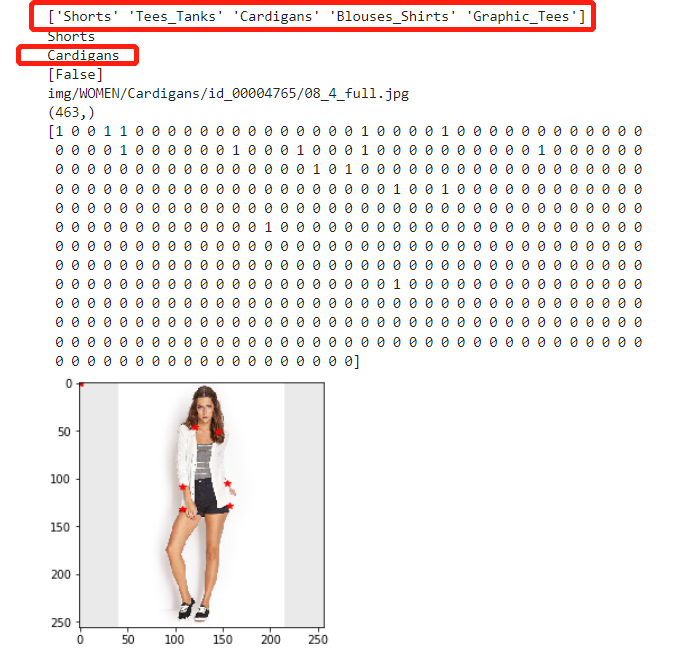

### 5.3 之后的开发计划

1. 制作一款在移动端运行的demo方便进行数据获取和算法测试等
2. 学习几何深度学习相关知识，构建3D模型检索系统
3. 将整个流程串起来，并寻找一些可用的大型3D衣物模型数据库

---

## 六、方案三：通过对扫描模型进行模型分割

### 6.1 概述

截取模型衣物，由于版型数据获取困难，通过扫描仪或者基深度学习方法进行人体建模相对容易，获取到人体重建模型后通过对模型进行语义分割抽取出其中的衣物

#### 6.1.1 人体重建

人体重建，基于单帧人体重建有关算法已经有比较多的尝试：比如经典的PIFU系列算法，现在该领域公开的最新的算法《Photolistic Human》效果

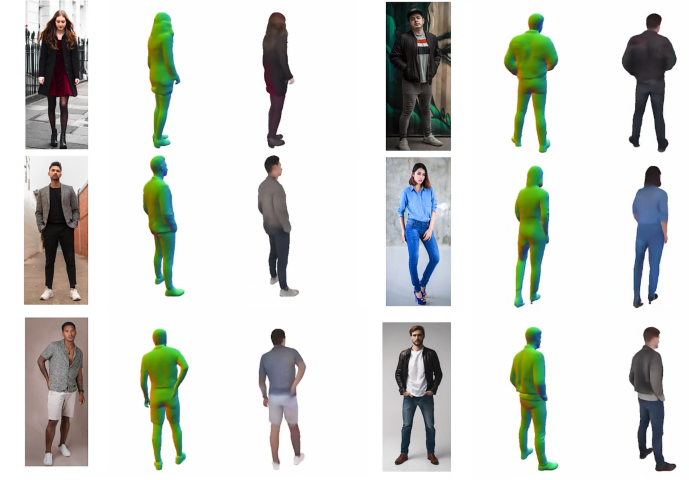

#### 6.1.2 语义分割抽取衣物

获取到人体模型后，通过对模型进行语义分割的方法抽取出衣物的3D模型，可以参考2维图像分割的方法如MRF等，也有更针对3D模型的方法

### 6.2 现有进展

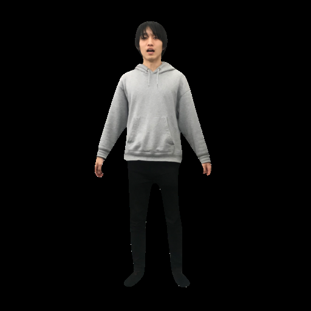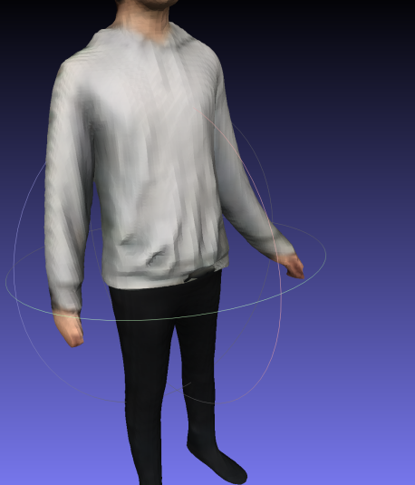

2. 实现了基于MRF的模型分割效果

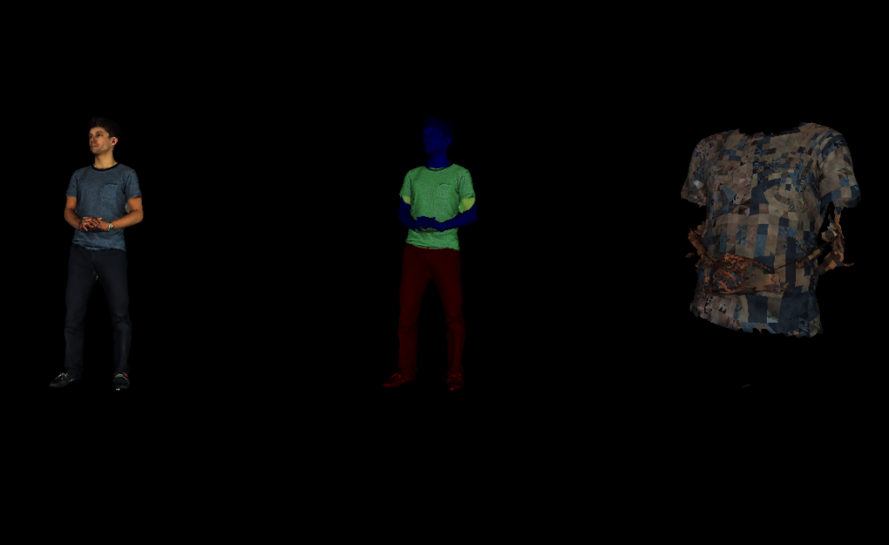

### 6.3 之后的开发计划

1. 进一步优化人体重建的效果，Pifu的隐式模型结合smpl参数模型，从而获得更准确的
2. 进一步优化模型分割效果，优化MRF算法或是采用其他模型分割算法

---

## 七、衣物重建系统进展

1. Demo1基于单帧的几何重建
2. 人体重建算法

   跑通了PIFU算法，并进行了简单实验(3.1.1)

3. 开发通过MRF方法实现了较好的模型衣物分割算法(3.1.2)
4. 根据《Garment sewing》(1.2、4.1) 所提出一套的服装版型参数系统，并开发了一个基于Maya的插件

   （插图）

5. 跑通了FahsionNet(2.1)，对

   （插图）

6. 跑通《Sensitive Contour》(插图)(4.2)

之后的开发计划

Demo 运行图

1. 完善FashionNet demo 1.制作一款在移动端运行的demo 2.尝试将FashionNet等获取到的衣物分类与现有的服装版型参数系统对接，实现衣物版型索引
2. 完善demo1，1.尝试将几何重建与纹理重建串起来。
3. 开发demo2，1.进一步优化人体重建的效果 2.进一步优化模型分割效果
4. 开发demo3,独立的简化MD的服装CAD软件工具
5. 复现DeepFashion3D，跑通BCNet、Simplicit的训练

---

## 八、衣物重建系统进展 9

1. Pix2Surf带上人体分割，增强输入的鲁棒性，采用U2Net效果基本达到要求

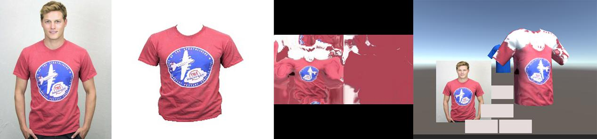

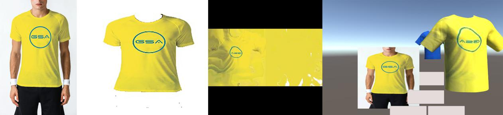

2. 关于"包"等类型物体的生成，可以参考SDMNet，通过定义一类物体的类型结构，SDMNet可以学习到该类型物体Mesh的隐空间，从而保持结构特征自动生成该类物体Mesh。

   该思路的已经有比较多的探索，包括SDMNet 、PartNet、Structure net、DSGNet等。

   如下示例可以定义两个不同形状的椅子（沙发）进行中间插值，生成一类椅子（沙发）

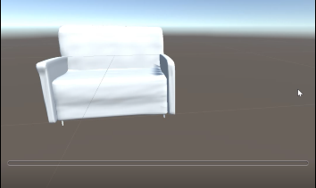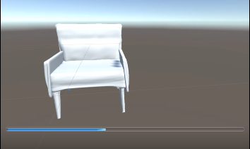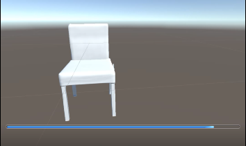

3. 手动捏服装可以参考以下文章的方法

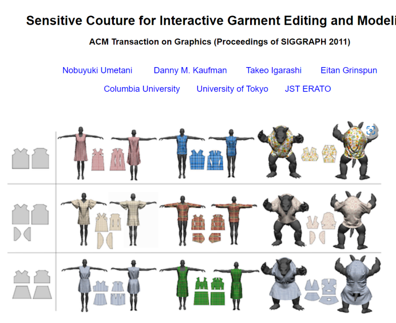

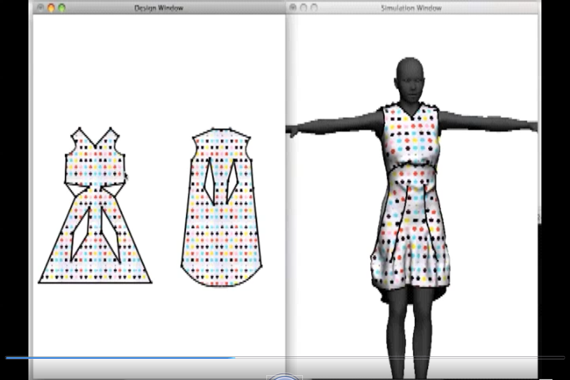

另外以下文章也能提供类似效果，可以通过GUI工具调整衣物的尺寸参数，不过依赖于布料结算工具

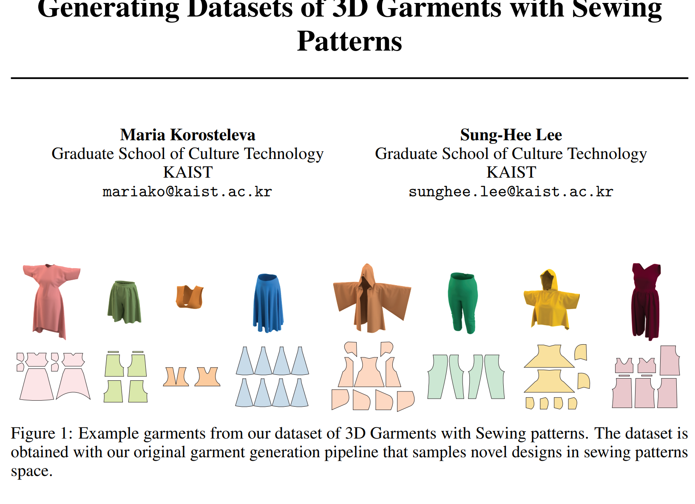

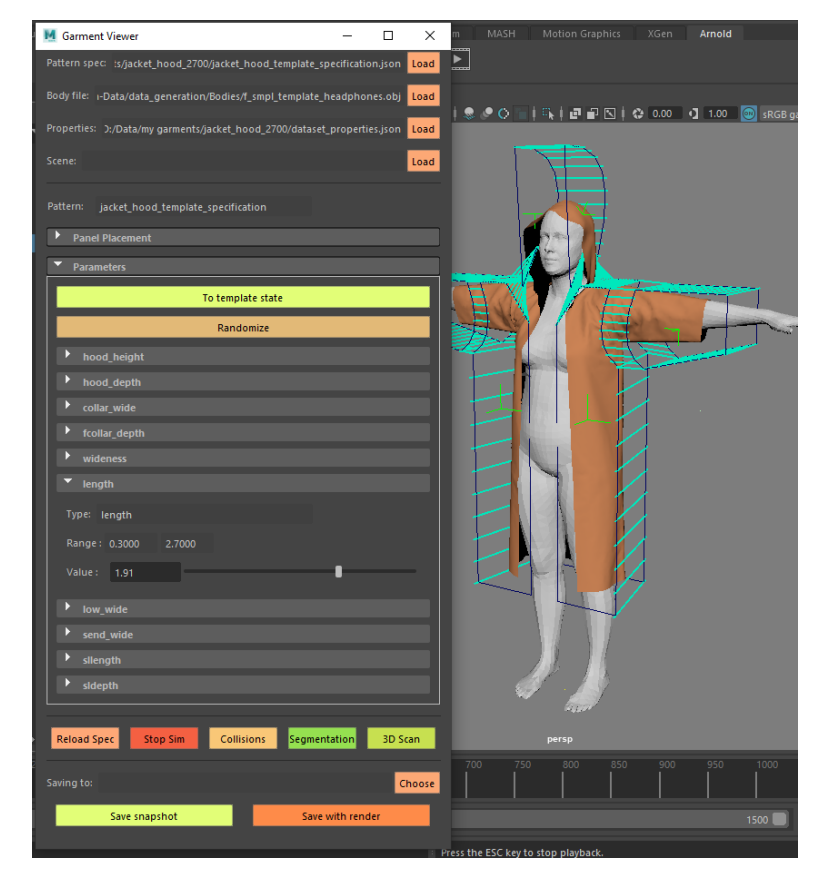

---

## 九、其他相关

1. 垂衣(Drape),垂衣即将已有的衣物模型适配到不同人体模型身上，现在有的思路主要是将衣物模型存储成Smpl+D，即将衣物模型的顶点与Smpl模型的顶点相对应。另外已知的公开文献有《Design preserve》有对该问题进行研究。

2. 现在已有的高精数字人衣物制作的手工流程是从MD到UE，在这中间通过trimiorror提供的udraper插件可以实现比较好的对接与在UE中良好的布料解算

---

## 十、附录

### 10.1 数字衣物的分级

1. 1.普通游戏中人物角色的衣物
2. 2.高精二次元游戏人物角色衣物 （插图）
3. 3.高精超写实数字人角色衣物

一、将衣物简化为人体的一部分,此类衣物模型制作方法一般无法体现衣物的动态特性与细节,无法处理蓬松的衣物,并且对于不同的人物形体同样的衣物需要制作多种符合形体的模型。

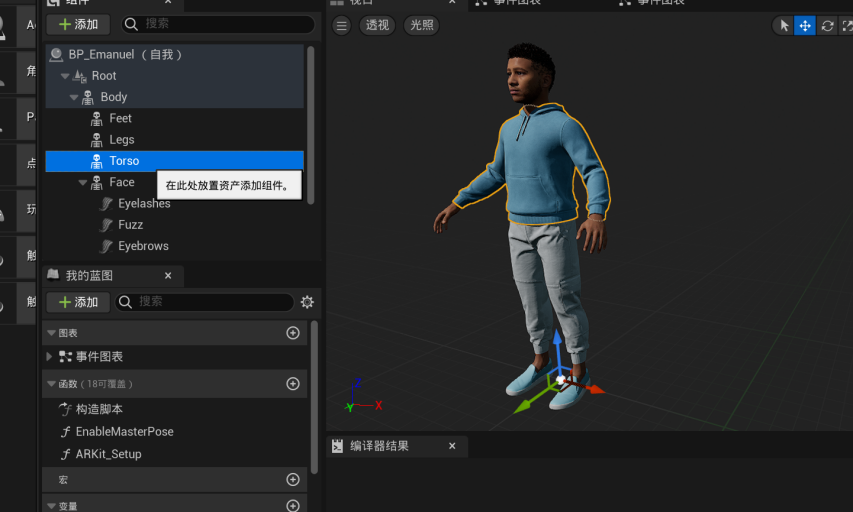

一般此类衣物的制作与其他游戏资产一样通过Maya或者3DSMax等工具进行制作。

### 10.2 传统服装设计流水线

### 1.3 现有衣物建模流程

现有衣物建模流程：1.Blender 2.MarvolousDesigner

二、传统的服装设计流水线主要分为三块：创作设计（款式图，包括款式、面料、色彩等等的表达）、结构设计（也叫**制版**，确定每个部位的具体规格尺寸）、工艺设计（也叫车位，一件成品的缝制过程）。制版在其中起到了承上启下的作用，它将设计师的设计理念转化为具体的生产指令，使得衣服能够真正被制作出来，并且既美观又舒适。

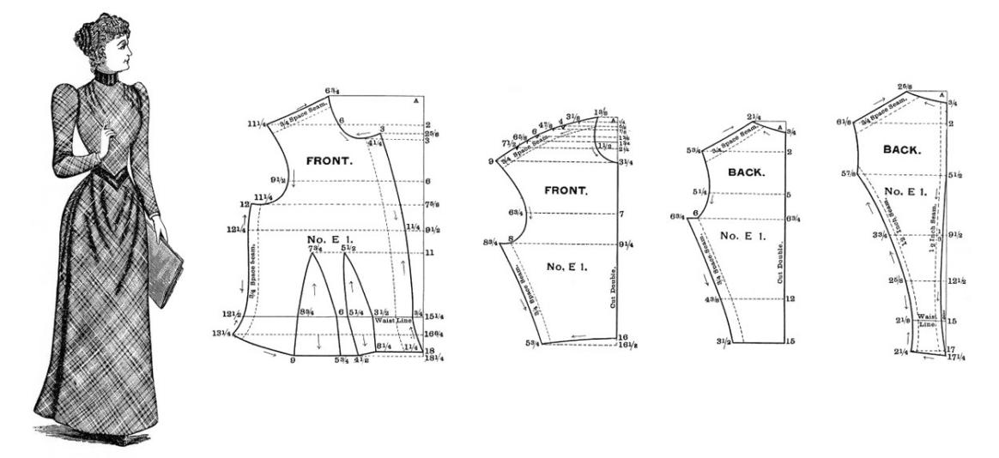

### 10.3 制版的难点

制版的难点在于，要根据设计师描绘的穿在人身上的服装，确定它是由哪几块平面布料所缝制成的。这其中涉及到的变量很多，比如平面布料的数量、形状，以及它们之间的缝合关系和缝合方式等。以数学的角度来说，制版师所操作的平面布料，和他想要验证的穿在人身上的服装，都不是在同一套参数空间里。所以制版师们往往是先从一些大概估计形状的平面布料开始，借助小钉把布料往人体模型身上裹（drape），做出想要得到的立体效果，然后用剪刀剪去多余的布料，或者如果这块布料不够大，就换更大的布料来重新尝试，如此往复，从而最终得到各布料的形状和缝合方式。由此可见，这项工作需要非常丰富的经验与十足的耐心，而且前期培训成本也很高。

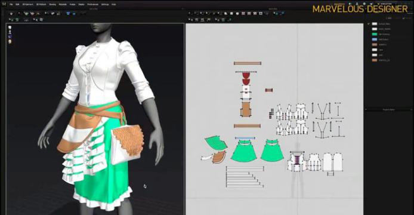

### 10.4 二维版型修改与三维直接编辑

通过二维版型的修改来进行衣物修改是比较复杂的，Physics-Driven Pattern Adjustment for Direct 3D Garment Editing提供了直接通过3d模型进行修改从而影响2d版型的

---

## 十一、参考文献

### 11.1 链接

- [迈向人工智能Fashion Design（一）- 服装制版模拟 - 知乎 (zhihu.com)](https://zhuanlan.zhihu.com/p/29620024)
- [人体三维重建（一）——绪论 - 知乎 (zhihu.com)](https://zhuanlan.zhihu.com/p/442488645)

### 11.2 资料原列参考

1. BCNet: Learning Body and Cloth Shape from A Single Image
2. Simplicit
3. MGN
4. Pix2Surf

### 11.3 正文中提及的其他方法

NeuralTailor、PIFU、ARCH、Icon、PAMIR、HumanNerf、IPNet（MPI_meshRegister、RVH_MeshRegister）、CoSeg、ClothCap、Cloth3D、Garment Database、DeepFashion、DeepFashion3D、TailorNet、SDMNet、PartNet、Structure Net、DSGNet、Design preserve、Physics-Driven Pattern Adjustment for Direct 3D Garment Editing、Sensitive Contour、U2Net、Garment sewing
