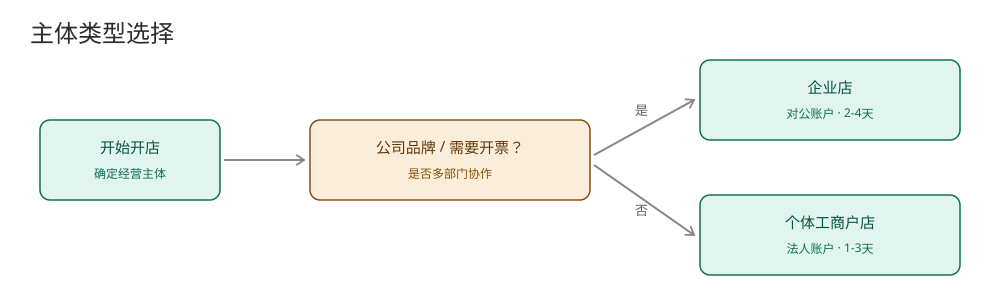

# 第 2 章　开店前准备

> **本章目标**：把入驻要用的材料和信息一次性备齐，避免反复驳回。
> **本章耗时**：0.5–1 天｜**失败风险**：材料不合格是驳回的头号原因（约占大部分驳回案例）。

---

## 本章要点

- 先选主体类型：企业店 vs 个体工商户店，直接影响材料和审核时长
- 材料必须是**清晰彩色原件照片或扫描件**，不接受截图、翻拍、模糊复印件
- 类目和资质要**提前预判**，不要等审核通过才查
- 合理预期：材料齐全的情况下通常 1 周内可开卖

---

## 2.1 主体类型选择

| 维度 | 企业店 | 个体工商户店 |
|---|---|---|
| 营业执照 | 企业营业执照 | 个体工商户营业执照 |
| 结算账户 | 必须对公账户 | 对公对私均可（绑法人本人账户） |
| 审核时长 | 约 2–4 个工作日 | 约 1–3 个工作日 |
| 适用场景 | 公司品牌、多部门协作、开票需求 | 小团队、夫妻店、快速试水 |
| 类目限制 | 全部类目 | 部分定向类目不支持个体户 |

**怎么选：**

- 公司名义经营、需要开票、后续要对接企业采购 → **企业店**
- 只是先把货卖起来、不想折腾对公账户 → **个体工商户店**
- 💡 已经有个体户执照的，别为了「看起来正规」去另办企业执照，个体户开店速度更快

---

## 2.2 材料清单

开店前把以下材料准备成**清晰彩色原件照片或扫描件**：

- [ ] **营业执照**（企业或个体工商户），且经营范围覆盖拟售商品
- [ ] **法人／经营者身份证件**正反面
- [ ] **超级管理员身份证件**（可与法人为同一人）
- [ ] **一个已实名的微信号**，作为超级管理员，需本人在手机端做人脸识别
- [ ] **结算账户**：企业店对公账户信息（开户名、账号、开户行）；个体户可用法人本人银行卡
- [ ] 拟售商品涉及的特殊资质（食品经营许可证、化妆品备案、品牌授权书等）

### 每项材料的硬性要求

| 材料 | 要求 | 常见错误 |
|---|---|---|
| 营业执照 | 状态正常（存续／在营），四角完整，文字清晰可读 | 用手机翻拍屏幕、边角裁掉、旧版执照信息过期 |
| 身份证件 | 正反面都要，在有效期内，无反光遮挡 | 只传正面、证件到期、手指遮挡号码 |
| 超级管理员 | 微信已完成实名，且与填报身份信息一致 | 用员工微信号填老板身份信息（人脸识别必然失败） |
| 结算账户 | 开户名与执照主体名称完全一致 | 企业店填了法人个人卡、账户名写了简称 |
| 特殊资质 | 在有效期内，主体与店铺主体一致 | 借用他人许可证、过期证照 |

> ⚠️ **易错**：所有证照的**主体名称必须完全一致**。执照叫「XX 市 XX 商贸有限公司」，账户名少一个字或写成「XX 商贸」，都会卡在账户验证环节。

### 证件照片怎么拍

1. 放在**纯色平面**上（白纸或深色桌面），避免木纹、花纹背景
2. 光线均匀，**关闭闪光灯**，避免反光和阴影
3. **四角完整入镜**，不要裁边
4. 用扫描类 App 导出「原图」或 PDF，比手机直拍更稳
5. 文件名改成「营业执照.jpg」「法人身份证正面.jpg」，避免上传时传错

---

## 2.3 类目与资质预判

上架商品前必须先申请对应的经营类目，每个类目要提交资质并审核约 2–3 个工作日。**多个类目不支持批量申请，需逐一提交**。建议在电脑端操作，系统有类目智能推荐。

需要提前查清的四件事：

1. 你的商品对应哪些类目（小店后台 → 店铺管理 → 类目管理 → 申请新类目）
2. 这些类目是否支持「零保证金试运营」
3. 是否属于定向准入类目（食品、美妆、盲盒等有特殊要求）
4. 主体类型是否符合（部分类目不支持个体户）

> 💡 **提示**：把商品清单先列出来，逐条对照类目。一个商品往往能归到多个类目，**选错类目会导致后续被下架**，而不是仅仅费率不同。拿不准时优先选更具体、更贴近实物性质的类目。

详细规则见 [第 4 章 类目与保证金](04-类目与保证金.md)。

---

## 2.4 时间成本预估

| 阶段 | 耗时 | 能否并行 |
|---|---|---|
| 准备材料 | 0.5–1 天 | — |
| 入驻审核 | 1–4 个工作日 | 可同时拍商品图、写详情 |
| 类目审核 | 约 2–3 个工作日 | 可与入驻审核并行准备资料，提交需在开店后 |
| 店铺装修 + 商品上架 | 0.5–2 天（视商品数量） | 类目审核期间即可动手 |
| **合计** | **通常 1 周内可开卖** | |

**关键路径提示：**

- 入驻审核和「拍图、写文案、找物流」可以**并行**，别干等
- 类目审核是第二个卡点，一开店就立刻提交申请，不要拖到商品都上完了才想起来
- 真正拖慢进度的一般不是平台审核，而是**商品图没拍好、详情没写**

---

## 2.5 准备阶段最容易卡住的 5 件事

| 卡点 | 原因 | 提前怎么办 |
|---|---|---|
| 查不到营业执照注册号 | 新执照工商信息尚未同步 | 等约 5 天后再申请 |
| 结算账户验证失败 | 开户名与主体不完全一致 / 个体店用了非本人卡 | 提前核对开户名，个体户必须法人本人账户 |
| 人脸识别总失败 | 超管微信号未实名或身份信息填错 | 用本人实名的微信号，光线正对脸部 |
| 类目申请被驳 | 资质与类目不匹配、缺件 | 先查类目所需资质清单，一次传全 |
| 店铺名称过不了 | 含极限词或与他人品牌近似 | 取名避开「最、第一、绝对、官方、旗舰」 |

---

**上一页** [第 1 章 认识与选型](01-认识与选型.md) ｜ [返回目录](README.md) ｜ **下一页** [第 3 章 入驻实操](03-入驻实操.md)
