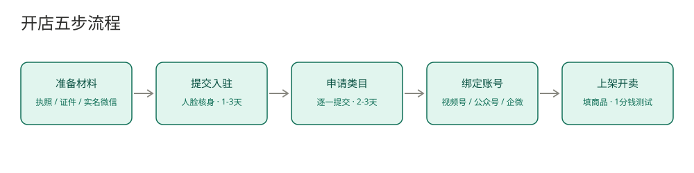

# 第 3 章　入驻实操

> **本章目标**：按步骤完成店铺入驻，提交后一次通过审核。
> **本章耗时**：操作约 30 分钟（不含审核等待）｜**前置条件**：[第 2 章](02-开店前准备.md) 材料已备齐。

---

## 本章要点

- 全程在手机端即可完成，操作时间约 30 分钟
- 六步走完提交审核，审核期间**无需重复提交**
- 超级管理员必须**本人**人脸识别，不能代办
- 提交后别干等，可以并行做商品图和类目准备

---

## 3.1 流程总览



```
① 选择店铺类型 → ② 填写开店信息 → ③ 管理员验证
        → ④ 填写店铺信息 → ⑤ 提交审核 → ⑥ 账户验证完成开店
```

---

## 3.2 入口

- **手机端**：打开微信 → 搜索栏输入「微信小店开店」→ 点击搜索结果中的「前往」→ 进入微信小店入驻页面
- **电脑端**：打开微信小店官方页面，按指引填写信息并上传材料

两端流程基本一致，以下按手机端说明。

> ⚠️ **易错**：只认准微信内搜索或官方页面。第三方网页、朋友转发的「代办开店链接」一律不要点（详见 [第 12 章](12-合规与避坑.md)）。

---

## 3.3 具体步骤

### 第 1 步：选择店铺类型
**⏱️ 1 分钟**

- 企业执照 → 选「企业」店铺
- 个体户执照 → 选「个体工商户」店铺
- 点击「开店」阅读经营须知 → 点击「同意并开店」进入资料填写

> ⚠️ **易错**：这一选**之后不能改**。个体户执照选成企业店，会在账户验证环节彻底卡死，只能重新申请。

### 第 2 步：填写开店信息
**⏱️ 10–15 分钟**

依次填写：

1. 营业执照信息（上传原件照片）
2. 结算账户信息（企业填对公账户；个体户填法人本人账户）
3. 法人身份证件
4. 超级管理员实名信息

填完后系统会有指引和示例，按要求清晰、正确上传。

**这一步的检查要点：**

- [ ] 执照上的名称、统一社会信用代码，与照片完全一致（含括号、中英文）
- [ ] 结算账户开户名 = 执照主体名称（一字不差）
- [ ] 身份证号、有效期填写与照片一致
- [ ] 超级管理员姓名／身份证号与后续做人脸识别的人**是同一人**

### 第 3 步：管理员验证
**⏱️ 2 分钟**

超级管理员本人进行**人脸识别**，需本人操作，不能代做。

> ⚠️ **易错**：人脸识别要在**光线充足、正对镜头**的环境下做。戴帽子、背光、戴美瞳都可能失败，连续失败多次可能触发冷却。

### 第 4 步：填写店铺信息
**⏱️ 5 分钟**

上传店铺头像、填写店铺名称等基础信息。

| 项 | 建议 |
|---|---|
| 店铺名称 | 2–10 字，好读好记，与主营品类相关，避开极限词与他人品牌 |
| 店铺头像 | 正方形、纯色或白底、主体清晰，避免复杂底图和大段文字 |
| 店铺简介 | 一句话说清卖什么、有什么优势，不要堆砌关键词 |

### 第 5 步：提交审核
**⏱️ 1 分钟提交，等待 1–4 个工作日**

提交后等待官方审核：

- 个体工商户：1–3 个工作日
- 企业：2–4 个工作日

审核期间无需重复操作，可在后台实时查看进度；审核通过后，管理员微信会收到通知。

> 💡 **提示**：审核是人工 + 系统结合，遇到节假日会顺延。**不要**因为等待焦虑而反复撤销重提，那只会重新排队。

### 第 6 步：账户验证，完成开店
**⏱️ 5–10 分钟**

审核通过后完成账户验证与结算账户配置，签约后即可解锁商品上架、直播带货、订单管理、资金结算等全部功能。

> ⚠️ **易错**：这一步常被忽略，很多人在「审核通过」后以为已经能卖了，实际还要完成账户验证和签约，商品上架入口才会完全开放。

---

## 3.4 常见驳回原因与对策

| 驳回原因 | 具体表现 | 怎么改 |
|---|---|---|
| 营业执照状态异常 | 已注销、吊销、经营异常名录 | 先处理工商异常，恢复正常状态后再申请 |
| 经营范围不匹配 | 卖食品但执照只写「日用品销售」 | 先做工商经营范围变更，或调整售卖品类 |
| 证件照片不合格 | 截图、翻拍屏幕、模糊、缺角、有遮挡 | 重新用扫描件或原图，按 [2.2 拍摄规范](02-开店前准备.md) 重拍 |
| 店铺名称含极限词 | 「最」「第一」「绝对」「国家级」 | 换名，去掉绝对化用语 |
| 店铺名称近似品牌 | 名字里带他人注册商标 | 换名，避免蹭品牌 |
| 特殊类目资质缺失 | 未上传食品经营许可证等 | 补齐资质，注意主体一致、在有效期内 |
| 结算账户信息错误 | 个体店未绑法人本人账户 / 开户名不一致 | 核对开户名，个体户改绑法人本人卡 |
| 超管信息与实名不符 | 填的姓名和做人脸识别的微信号不一致 | 换成本人实名微信号重新验证 |

---

## 3.5 被驳回后怎么办

```
收到驳回通知
   ├─ 原因属于「材料问题」→ 补拍／补传 → 重新提交（不用重新开店）
   ├─ 原因属于「执照问题」→ 先办工商变更／解除异常 → 再重新提交
   └─ 原因属于「主体选错」→ 只能放弃当前申请，用正确执照重新入驻
```

> 💡 **提示**：驳回通知里通常会写明具体问题项。**按提示逐条改**，不要凭猜测整体重填，否则容易引入新错误。

---

## 3.6 提交之后别干等：并行任务清单

审核的 1–4 天是最容易被浪费的时间，可以同时做这些：

- [ ] 拍商品主图和详情图（最花时间的一项）
- [ ] 写好 3–5 个商品的标题和详情文案
- [ ] 列清商品对应类目，准备好各类目所需资质（开店后立刻提交）
- [ ] 联系快递、问清发货价与时效，确定运费模板方案
- [ ] 想好店铺名称和头像（避免提交时临时纠结）
- [ ] 检查你的视频号／公众号是否可用，缺少的先注册

---

**上一页** [第 2 章 开店前准备](02-开店前准备.md) ｜ [返回目录](README.md) ｜ **下一页** [第 4 章 类目与保证金](04-类目与保证金.md)
