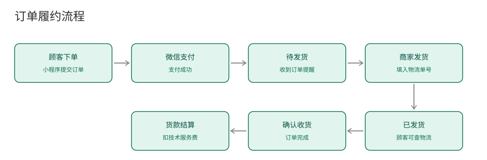
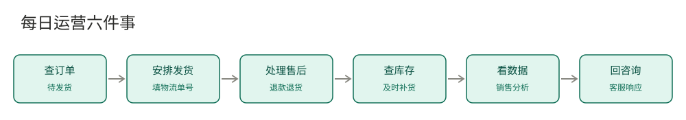

# 第 9 章　日常运营

> **本章目标**：把开店后的日常动作固化成固定节奏，避免漏单、漏售后、漏补货。
> **本章耗时**：每天 15–30 分钟。

---

## 本章要点

- 运营的本质是**不漏事**：发货、售后、库存、数据、回复，五件事每天过一遍
- 固定时间做固定事，比想起来才做有效得多
- 看懂四个数就够了：成交额、转化率、退款率、客单价

---

## 9.1 订单履约流程



```
买家下单 → 待发货 → 打包发货 → 填单号 → 已发货
   → 运输中 → 已签收 → 售后期届满 → 结算
                          ↑
                    售后可能在任何环节插入
```

---

## 9.2 每日运营六件事



建议每天固定时间处理以下事项：

- [ ] 查看待发货订单，安排发货
- [ ] 处理退款／售后申请
- [ ] 检查库存，及时补货或修改缺货商品
- [ ] 查看数据看板，了解昨日销售额与热销品
- [ ] 回复顾客咨询（客服自动回复可覆盖常见问题）
- [ ] 发 1 条内容（短视频／朋友圈／社群），保持店铺活跃

---

## 9.3 运营节奏表

| 周期 | 要做的事 |
|---|---|
| **每天** | 发货、处理售后、回咨询、看库存、看昨日数据 |
| **每周** | 复盘热销与滞销款；调整标题／主图；补拍内容素材；核对库存周转 |
| **每月** | 对账（见 [第 7 章](07-支付与结算.md)）；算真实毛利；清理长期滞销品；检查资质证件有效期；看平台公告与规则更新 |

---

## 9.4 数据看板四个核心指标

| 指标 | 含义 | 低了说明什么 | 怎么改善 |
|---|---|---|---|
| 成交额（GMV） | 一段时间内的订单总金额 | 流量不足或转化差 | 增加内容曝光、优化主图与价格 |
| 支付转化率 | 访问 → 下单付款的比例 | 商品页说服力不够 | 补详情、加评价、明确发货时效 |
| 退款率 | 退款订单占比 | 描述与实物不符／物流慢／质量问题 | 核对详情描述、优化包装与发货 |
| 客单价 | 平均每单金额 | 单价太低或没有连带 | 做套装、满减、加购推荐 |

> 💡 **提示**：新店前 20 单不要看转化率，数据量太小没有意义。先关注「有没有人下单」和「退款率高不高」。

---

## 9.5 库存管理

- 库存是所有渠道共享的：小店、直播、线下同时卖时，注意**超卖风险**
- 设置低库存提醒，热销款保持安全库存
- 季节性商品提前 2–4 周备货
- 长期滞销（如 60 天 0 成交）及时下架清库存，避免占用资金和影响店铺动销

---

## 9.6 客服响应建议

| 场景 | 建议做法 |
|---|---|
| 咨询发货时间 | 自动回复覆盖，人工补充具体日期 |
| 咨询尺码／规格 | 主动问需求，给推荐而不是丢参数表 |
| 催单／催物流 | 先查件再回复，给出明确时间预期 |
| 投诉质量 | 先道歉再解决，避免争对错 |
| 要求私下退款 | 拒绝，坚持走平台流程 |

---

## 9.7 月度体检清单

- [ ] 本月成交额、退款率、客单价与上月对比
- [ ] 技术服务费实际费率与预期是否一致
- [ ] 是否有商品被下架／违规提醒
- [ ] 资质证件是否临近到期
- [ ] 是否有长期未处理的售后／纠纷
- [ ] 爆款是否需要备货加量
- [ ] 平台新政策是否需要调整经营方式

---

**上一页** [第 8 章 物流与售后](08-物流与售后.md) ｜ [返回目录](README.md) ｜ **下一页** [第 10 章 营销与流量](10-营销与流量.md)
