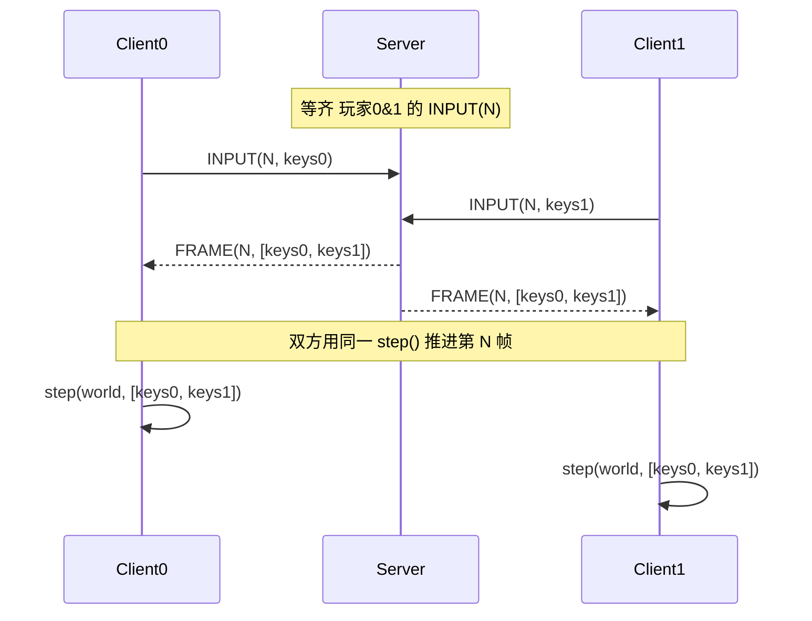
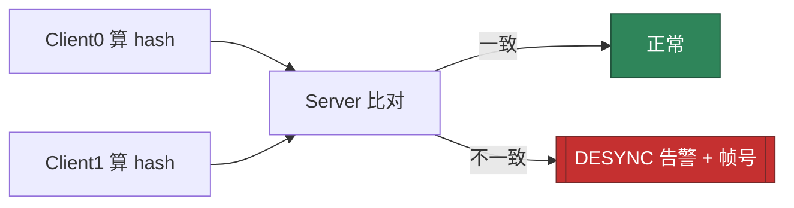

# 帧同步双人合作网页游戏 — 开发计划

> 状态：规划中
> 技术选型：TypeScript + Vite（前端） / Node.js + `ws`（中继服务器） / HTML5 Canvas（渲染）
> 运行形态：局域网两台机器，一台运行中继服务器，两台浏览器各连一个客户端
> 玩法：双人同行（co-op）合作小游戏

---

## 1. 项目概述

做一个**基于帧同步（Lockstep / 帧同步）**的最小可演示双人合作网页游戏：

- 两名玩家各自用浏览器打开同一地址，控制场景中各自的角色。
- 所有客户端维护**完全相同的初始状态**，按**完全相同的帧顺序**应用**完全相同的输入序列**，各自跑同一套确定性模拟，逐帧得到一致的世界状态——网络上只同步"操作指令"，不同步坐标/血量等状态。
- 玩法设计为"双人同行"：两名玩家必须**互相配合**才能过关（例如各自踩住压力板，两人同时踩下才打开出口门），从而直观体现"两边世界必须一致"这一帧同步核心要求。

### 1.1 为什么选网页方案

| 维度 | 说明 |
|---|---|
| 浮点一致性 | JavaScript `Number` 是 ECMAScript 规范强制的 **IEEE 754 双精度**，V8 / SpiderMonkey / JavaScriptCore 算术结果比特级一致 → 跨机器/跨浏览器天然确定，**无需定点数**（对比 C++ 必须小心） |
| 部署成本 | 一台机器 `npm start` 起中继 + 静态服务，另一台浏览器开 URL 即可，**零安装零编译** |
| 渲染 | Canvas 2D 内置，适合画方块/关卡 |
| 消息 | WebSocket 提供可靠有序传输，对锁步最省心 |

> 注：因为 web 浮点太一致，"故意改成 float 看跨机器 desync"这一实验在网页里抓不到 CPU 级差异；但哈希校验仍能抓出更常见的非确定性 bug（`Math.random()`、`Date.now()`、对象键遍历顺序等），仍有教学价值。

---

## 2. 核心概念：帧同步是什么

**帧同步（Lockstep）** 与常见的"状态同步"是两套思路：

- **状态同步**：服务器权威，每帧把世界状态（坐标、血量…）下发给客户端；带宽大，但客户端无需确定性。
- **帧同步**：服务器不模拟逻辑，只转发"输入指令"；客户端用确定性模拟自行算出相同结果；带宽极小（每帧仅几个字节按键），但要求**确定性**与**锁步推进**。

帧同步的不变式（必须满足，否则 desync）：

1. **逻辑与渲染分离**：模拟按固定步长推进；渲染只读取最新状态做绘制/插值。
2. **只同步输入**：每帧只广播本地按键，不发送状态。
3. **确定性**：`new_state = step(old_state, inputs[N])` 在所有客户端算出完全相同结果。
4. **锁步推进**：客户端不能提前模拟第 N 帧，直到收齐所有玩家第 N 帧输入。

---

## 3. 架构设计

服务器扮演**「帧时钟 + 中继」**双重角色：不模拟任何逻辑，仅"收齐本帧所有玩家输入 → 广播 → 推进帧号"。客户端无需自己协商帧节奏，锁步最简单、最稳。

```mermaid
flowchart LR
  subgraph M1[机器 A：Node 中继 + 静态服务]
    S[server.js<br/>HTTP 托管 client + WS 帧中继]
  end
  subgraph B1[机器 A 浏览器]
    C0[Client 玩家0<br/>Canvas 渲染 + 确定性模拟]
  end
  subgraph B2[机器 B 浏览器]
    C1[Client 玩家1<br/>Canvas 渲染 + 确定性模拟]
  end
  C0 -->|INPUT(N,keys)| S
  C1 -->|INPUT(N,keys)| S
  S -->|FRAME(N,keys[2])| C0
  S -->|FRAME(N,keys[2])| C1
  style S fill:#2b6cb0,stroke:#1a365d,color:#fff
  style C0 fill:#2f855a,stroke:#22543d,color:#fff
  style C1 fill:#c05621,stroke:#7b341e,color:#fff
```

### 3.1 组件职责

| 组件 | 职责 |
|---|---|
| `server/server.js` | 托管 `client/` 静态文件（HTTP）；WebSocket 中继：收齐两人第 N 帧输入 → 广播 `FRAME(N)`；为连接分配玩家 ID（先连=0，后连=1）；满 2 人后发 `START` |
| `client` 模拟内核 | `World` 状态 + 纯函数 `step(world, keys)` 确定性推进 |
| `client` 网络层 | WebSocket 客户端封装：发 `INPUT`、收 `FRAME`/`ID`/`START` |
| `client` 渲染层 | Canvas 绘制两个角色、墙、压力板、门、HUD（帧号 / 哈希 / desync 提示） |
| `client` 输入层 | 采集键盘，编码为位掩码 |

---

## 4. 帧同步协议

传输：WebSocket，消息为 **JSON**（demo 负载极小，每帧仅一个字节按键，JSON 可读性优先）。未来可换二进制长度前缀协议降开销。

### 4.1 消息格式

```ts
// 客户端 → 服务器
interface MsgInput  { type: 'INPUT';  frame: number; keys: number; }   // keys: 位掩码
// 服务器 → 客户端
interface MsgId     { type: 'ID';     id: 0 | 1; }
interface MsgStart  { type: 'START';  frame: number; }
interface MsgFrame  { type: 'FRAME';  frame: number; keys: [number, number]; }
interface MsgHash   { type: 'HASH';   frame: number; hash: number; }   // desync 校验用（可选）
```

按键位掩码（bit）：`UP=1, DOWN=2, LEFT=4, RIGHT=8, ACTION=16`。

### 4.2 锁步流程（服务器即帧时钟）



- 客户端用当前 `world.frame` 给 `INPUT` 打帧号；收到 `FRAME(N)` 后 `step` 把帧号推进到 N+1，下一份 INPUT 自动标为 N+1 → 天然对齐服务器帧时钟。
- 网络抖动只表现为"偶发卡一帧"，不会 desync（因为双方都严格按 `FRAME` 推进）。

---

## 5. 确定性模拟

### 5.1 为何 web 浮点天然一致

ECMAScript 规范强制 `Number` 为 IEEE 754 双精度，且对 `+ - * /`、取余、Math 函数等的舍入有明确规约。因此同一段 JS 在两个不同浏览器/机器上运行，算术结果逐位相同。**无需定点数**。

### 5.2 确定性要点清单（硬性约束）

| 规则 | 做法 |
|---|---|
| 禁止非确定性随机 | 模拟内禁用 `Math.random()`；若需随机用 `mulberry32` 等确定性 PRNG，种子握手时统一下发 |
| 禁止本地时间 | 模拟内禁用 `Date.now()` / `performance.now()` 决定结果；只用帧号 |
| 有序遍历 | 墙/实体用**有序数组**按索引遍历，禁用 `Object.keys()` 顺序依赖 |
| 固定步长 | `step` 内 `dt` 为常数；物理积分与帧率解耦 |
| 单线程 | 模拟在主线程，不依赖 `setTimeout`/`Worker` 时序 |
| 纯函数 | `step(world, keys)` 只改传入的 `world`，无隐藏外部状态 |

### 5.3 World 状态与 step 接口（TS 提案）

```ts
export const STEP_W = 800, STEP_H = 600;

export interface World {
  x: [number, number];   // 两玩家 x 坐标（双精度，确定性）
  y: [number, number];
  vx: [number, number];
  vy: [number, number];
  plate: [boolean, boolean];  // 压力板是否被踩
  exitOpen: boolean;          // 门是否开（合作条件：两人同时踩板）
  frame: number;
}

export function makeWorld(): World {
  return { x: [60, STEP_W - 60], y: [STEP_H / 2, STEP_H / 2],
           vx: [0, 0], vy: [0, 0], plate: [false, false],
           exitOpen: false, frame: 0 };
}

// 纯函数式确定性推进：同输入 → 所有客户端同结果
export function step(w: World, keys: [number, number]): void {
  for (let p = 0; p < 2; p++) {
    // 1) 按位掩码改速度
    // 2) 积分位置 vx,vy -> x,y
    // 3) 与有序墙数组做 AABB 碰撞修正
    w.plate[p] = onPlate(w, p);
  }
  w.exitOpen = w.plate[0] && w.plate[1];   // 双人同行：必须合作
  w.frame++;
}
```

---

## 6. 游戏玩法设计（双人同行）

- **场景**：单个 2D 关卡（俯视），含若干墙体、两个压力板（A 蓝、B 橙）、一个出口门。
- **角色**：玩家 0（蓝方块）、玩家 1（橙方块），各自用方向键 + 动作键控制。
- **合作机制**：出口门默认关闭；**仅当两人同时各自踩在自己的压力板上时门才打开**。任一人离开则关门。两人需配合卡位/互相等待才能一起通过——直观体现"两边状态必须一致"。
- **操作映射**：玩家 0 用 `WASD` + `Space`；玩家 1 用方向键 + `Enter`（或统一方向键 + 动作键，按玩家 ID 映射）。
- **胜负/进度**：两人都进入开启的门 → 本关通过，显示"通关"。

---

## 7. Desync 校验

- 每 60 帧对 `World` 全部状态（坐标、速度、压力板、门、frame）计算一次 `FNV-1a` 哈希。
- 客户端把 `HASH(frame, hash)` 上报服务器（或互发），服务器比对双方哈希：不一致即打印并广播 `DESYNC` 告警。



- 教学实验：在 `step` 里故意写一行 `Math.random()` 或 `Date.now()`，运行后哈希校验会立刻在双方抓出不一致，定位非确定性来源。

---

## 8. 项目结构

```
frame_sync_web/
├── package.json            # 依赖 ws；脚本 "start"（启动中继+静态服务）、"dev"（vite）
├── tsconfig.json           # 前端 TS 配置
├── vite.config.ts          # Vite 配置（root=client）
├── server/
│   └── server.js           # Node: 托管 client 静态文件 + WS 收齐输入/广播帧
└── client/
    ├── index.html          # <canvas> + 入口
    └── src/
        ├── main.ts         # 锁步循环: 采集键盘→发INPUT→收FRAME→step→render
        ├── world.ts        # World 状态 + step() 确定性推进
        ├── rng.ts          # mulberry32 确定性随机(种子握手下发)
        ├── hash.ts         # FNV-1a 对世界状态求哈希
        ├── net.ts          # WebSocket 客户端封装(收发 JSON 消息)
        ├── input.ts        # 键盘采集 → 位掩码
        └── render.ts       # Canvas 绘制 + HUD
```

---

## 9. 实现里程碑

### M1 — 中继 + 锁步骨架
- [ ] `package.json` / `tsconfig.json` / `vite.config.ts`
- [ ] `server/server.js`：静态托管 + WS 中继（ID 分配、收齐 INPUT、广播 FRAME）
- [ ] `client/src/net.ts`：连接、收发 JSON
- [ ] 验收：单机开两个浏览器标签，控制台能看到双方 FRAME 正常推进、帧号一致

### M2 — 确定性模拟 + 回放验证
- [ ] `client/src/world.ts` + `step()`
- [ ] `client/src/rng.ts`（备用）
- [ ] 本地脚本：用固定输入序列两端回放，断言 `World` 逐位相同
- [ ] 验收：回放结果一致；故意插入 `Math.random()` 时断言失败

### M3 — 渲染 + 输入
- [ ] `client/src/input.ts`：键盘 → 位掩码
- [ ] `client/src/render.ts`：画两角色/墙/板/门 + HUD（帧号）
- [ ] `client/src/main.ts`：rAF 采集输入→发 INPUT；收 FRAME→step→render
- [ ] 验收：单机双标签可各自用键盘控制，两边画面同步移动

### M4 — Desync 校验 + 局域网联调
- [ ] `client/src/hash.ts` + `checkHash`，每 60 帧上报；服务器比对告警
- [ ] 验收：机器 A `npm start`，机器 B 开 `http://<A的IP>:8080`，两人联机同步；插入非确定性后双方报 DESYNC

### M5 — 可选增强
- [ ] 输入延迟缓冲 / 预测回滚（改善手感）
- [ ] 关卡推进 / 多关
- [ ] 二进制协议替代 JSON 降开销
- [ ] UDP + 自研可靠层（降延迟，替代 WS）

---

## 10. 关键风险与对策

| 风险 | 对策 |
|---|---|
| 一方掉线/卡顿导致锁步停摆 | 服务器设超时：某玩家长时间无 INPUT 则视为"空输入"或踢出并重开；M1 先简单处理为等待 |
| 非确定性来源难查 | 哈希校验 + 定期 dump 状态 diff，定位首个分歧帧 |
| 手感延迟（严格锁步无预测） | M5 加输入预测 + 回滚（rollback netcode） |
| 端口/防火墙（LAN 不通） | 文档注明默认端口（如 8080），必要时改端口/关防火墙 |
| 两台机器时钟/时区差异 | 模拟绝不依赖墙钟，仅用帧号，天然免疫 |

---

## 11. 开发环境与运行方式

依赖：Node.js（中继）、现代浏览器（客户端）。前端用 Vite 提供开发服务器与构建。

```bash
# 安装依赖
npm install

# 机器 A：启动中继 + 静态服务（默认 http://0.0.0.0:8080）
npm start

# 机器 A 与机器 B：浏览器打开
#   机器 A: http://localhost:8080
#   机器 B: http://<机器A的局域网IP>:8080
```

`package.json` 脚本草案：

```json
{
  "scripts": {
    "start": "node server/server.js",
    "dev": "vite",
    "build": "vite build"
  },
  "dependencies": { "ws": "^8" },
  "devDependencies": { "vite": "^5", "typescript": "^5" }
}
```

> 说明：开发期可让 Vite 单独跑前端（`npm run dev`），生产/联调由 `server.js` 同时托管静态文件与 WS，免去单独前端服务器。

---

## 12. 测试计划

1. **单元/回放测试**：固定输入序列双端回放，断言 `World` 完全一致（M2）。
2. **确定性负向测试**：在 `step` 注入 `Math.random()`/`Date.now()`，断言哈希校验报 DESYNC（M4）。
3. **联调测试**：两台机器真实联网，验证同步移动、合作开门、通关（M4）。
4. **异常测试**：一方关闭标签页，验证服务器行为与重连/重开逻辑（M5 前至少记录现象）。

---

## 附：参考链路

- 帧同步核心：初始状态一致 + 输入序列一致 + 帧序一致 → 结果一致
- 服务器职责边界：只转发输入、只当帧时钟，不模拟
- 确定性三禁：禁 `Math.random()`、禁 `Date.now()`、禁依赖对象键顺序
- Desync 必备：状态哈希 + 定期比对
