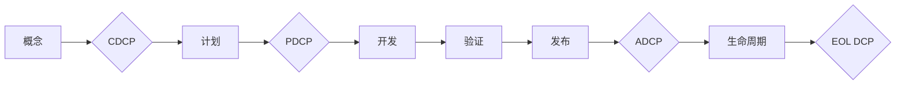

## 华为IPD流程

IPD（Integrated Product Development）1999 年由 IBM 引入华为，核心是把"产品开发"当成**投资行为**来管理：用阶段划分控制风险，用决策评审点（DCP）控制资源投入，用技术评审点（TR）控制质量。

### 六阶段

| 阶段 | 主要工作 | 出口 |
|---|---|---|
| 概念 (Concept) | 机会与市场分析、**概念初步**（Charter/任务书）、**概念完善**（产品包需求雏形）、初始业务计划 | CDCP |
| 计划 (Plan) | 产品包需求基线、系统架构与总体方案、最终业务计划（市场/研发/供应/服务/财务）、资源承诺 | PDCP |
| 开发 (Develop) | 详细设计、编码/**样机（原型）开发**、BBFV（构建模块功能验证）、技术评审 | TR4 / TR4A |
| 验证 (Verify) | 系统测试、Beta 试用、认证与可制造性验证 | TR5 |
| 发布 (Launch) | 量产准备、上市与渠道、服务与支持体系就绪 | ADCP、TR6 |
| 生命周期 (Lifecycle) | 版本维护、降成本、优化与退市 | LDCP / EOL |

### 决策评审点 DCP

DCP（Decision Check Point）是**业务/投资决策**，由 **IPMT**（Integrated Portfolio Management Team，集成组合管理团队）主持，结论三选一：**Go / No-Go / Redirect**。每个 DCP 有明确的交付件基线与评审要素，通过即"基线化"，后续变更要走变更流程。

| 决策点 | 位置 | 决策内容 |
|---|---|---|
| Charter DCP（任务书/立项评审） | 概念阶段前 | 是否立项、组建 PDT、承诺初步资源 |
| **CDCP**（Concept DCP） | 概念阶段末 | 产品包需求与初始业务计划是否成立，能否进入计划阶段 |
| **PDCP**（Plan DCP） | 计划阶段末 | 最终业务计划与资源承诺；**是否真正投钱开发**，是资源投入最大的闸门 |
| **ADCP**（Availability DCP） | 发布阶段 | 是否量产、上市（GA） |
| **LDCP / EOL DCP** | 生命周期末 | 停产、退出决策 |

### 技术评审点 TR

TR（Technical Review）是**技术质量评审**，由技术专家/SE 主导，看"做得对不对"，不做资源决策。

| 评审点 | 对象 |
|---|---|
| TR1 | 产品包需求（含客户需求分解） |
| TR2 | 系统需求与架构设计 |
| TR3 | 概要设计（模块划分、接口） |
| TR4 | 详细设计 + BBFV（构建模块功能验证） |
| TR4A | TR4 后的补充评审（较大变更/增量特性） |
| TR5 | 系统验证（功能、性能、可靠性） |
| TR6 | 发布技术评审（可制造性、可服务性、文档齐套） |

### DCP 与 TR 的配对

规则：**DCP 前必须有对应 TR 通过**，否则不带上会。常见对应关系：

| DCP | 前置 TR |
|---|---|
| CDCP | TR1、TR2 |
| PDCP | TR3（部分产品线含 TR4 前期成果） |
| ADCP | TR5、TR6 |

### 组织与角色

- **IPMT**：投资决策层，管"做不做、投多少"；
- **PDT**（Product Development Team）：跨部门执行团队（研发、市场、供应链、服务、财务、质量），PDT 经理对业务成功负责；
- **功能部门**：出人、出能力、出流程，与 PDT 是矩阵关系。

### 几条易混点

- **DCP ≠ TR**：DCP 决策资源，TR 决策技术；两者互补，缺一不可。
- DCP 一般**不可裁剪**，TR 可按项目规模与风险裁剪（小项目合并评审）。
- "先僵化、后优化、再固化"：华为引入 IPD 的落地节奏——先照抄流程，再按业务裁剪，最后沉淀为制度。
