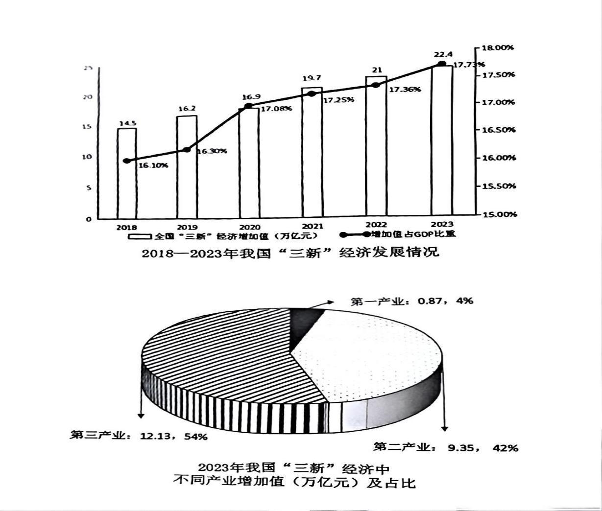

# 2025 年北京市公务员录用考试申论（真题）

> 来源：`2027考季 京考199讲义（三期）.docx` · 知识点十 套题练习
> 说明：资料 1 中的“三新”经济统计图已导出至 `assets/三新经济统计图.jpeg`

## 作答要求

1. 根据给定材料1-5，用一段话概括我国“三新”经济的发展状况。（20分）要求：准确全面，语言简练，不列条目。不超过300字。

2. 给定材料5中提到：“推行‘沙盒监管’，无疑恰到好处地找到了平衡点，这是一个多方共赢的创新之举。”谈谈你对这句话的理解。（15分）要求：分析合理，条理清晰，语言简练。不超过250字。

3. 假如你是给定材料7中K市商务局调研组成员，针对调研中发现的问题，提出推进幸福广场周边首发经济发展的意见建议。（25分）要求：建议合理可行，针对性强，条理清晰，语言简练。不超过400字。

4. 给定材料8中提到：“尝新本就不寻常，要从‘尝新’到‘常新’，更需要不断地探索和实践。”深入思考这句话，参考但不拘泥于所有给定材料，自选角度，自拟题目，写一篇文章。（40分）要求：观点鲜明、正确，分析深入、合理，语言流畅、字数控制在800-1000字。

## 资料1

1. 进入新发展阶段，贯彻新发展理念，构建新发展格局，是由我国经济社会发展的理论逻辑、历史逻辑、现实逻辑决定的。立足新发展阶段、贯彻新发展理念、构建新发展格局，必须深入实施创新驱动发展战略，完善国家创新体系，坚持创新在我国现代化建设全局中的核心地位。

2. 党的十八大以来，我国加快实施创新驱动发展战略，深化体制机制改革。党的二十届三中全会审议通过的《中共中央关于进一步全面深化改革、推进中国式现代化的决定》提出了300多项改革任务，其中提到“构建支持全面创新体制机制”，强调“提升国家创新体系整体效能”。一方面，作为经济发展核心动力的技术创新要素，正在不断取得重大突破。另一方面，新技术应用于各行各业及国民经济方方面面，衍生出大量新产业、新业态和新商业模式。

3. “三新”经济，是以新产业、新业态、新商业模式为核心内容的经济活动的集合。其中，新产业指应用新科技成果、新兴技术而形成一定规模的新型经济活动。新业态指顺应多元化、多样化、个性化的产品或服务需求，依托技术创新和应用，从现有产业和领域中衍生叠加出的新环节、新链条、新活动形态。新商业模式指为实现用户价值和企业持续盈利目标，对企业经营的各种内外要素进行整合和重组，形成高效并具有独特竞争力的商业运行模式。国家统计局于2017年正式开展“三新”经济核算，2018年首次发布我国“三新”经济增加值数据，并发布《新产业新业态新商业模式统计分类（2018）》，明确“三新”经济分为9个大类、63个中类、353个小类。下图是我国“三新”经济的有关统计数据。

## 资料2

1. 在一场展会上，一位小伙用“AR试穿”功能“云试穿”了几双球鞋后，当场就下单购买。

2. “在手机上就能获得几乎真实的上脚试穿体验，大小尺寸、细节特征一目了然。”“云试穿”背后依靠的是以元宇宙为代表的数字化创新“黑科技”，某参展商表示：“在‘三新’经济的推动下，人们对商品品质、消费体验的潜在需求正在规模性释放，购物便捷性不断提高，新型消费快速发展，线上消费占比持续提高。”

3. 曾经，元宇宙对大多数人而言是一项遥不可及的技术。如今随着新技术不断完善，元宇宙与越来越多应用搭上界，实现跨界融合。一家互联网公司利用元宇宙开发了能够应用于线上观会和社交互动体验的平台，通过复刻大会真实场景，融合线上与线下，为参会者打造了沉浸式元宇宙观会体验。人们进入其中，就会被赋予一个虚拟形象，仿佛置身展会中，在“现场”观看展览、聆听报告、翻阅演讲PPT，视听效果几乎可以媲美现场。

4. 《中国元宇宙发展报告（2022）》显示，我国元宇宙上下游产业目前产值超过4000亿元，主要体现在游戏娱乐、VR和AR硬件等方面。未来五年，国内元宇宙市场规模将持续扩大，发展前景广阔。专家张一垚教授认为，元宇宙将先进技术与传统产业深度融合，通过数字化、智能化改造，使传统产业的生产效率、产品质量和市场竞争力得到显著提升，进而实现转型升级。同时它还能不断催生新业态新模式，开发出爆款产品，促进释放巨大市场价值，赋能千行百业，推动其持续爆发增长。

## 资料3

1. 走进白领小桐的房间，就仿佛瞬间落入了一个“软白的梦境”——头上长着小草的大大小小的可爱“白团子”，以玩偶、摆件、抱枕的形式摆放在房间的每一个角落。“第一次见到‘团子’，我就被它软萌的外表和可爱的表情‘吸粉’了。”小桐说。

2. 这个名为“长草颜团子”的形象，是北京一家文化传播公司于2015年推出的IP（品牌形象）。据公司负责人介绍，作为公司的“顶流”形象，“长草颜团子”表情包的累计下载量和使用量分别超过13亿次和350亿次。

3. 某网络研究院王研究员介绍，得益于国内互联网社交类应用的巨大用户规模，“现象级表情包”不断涌现。以“乖巧宝宝”系列表情包为例，仅其中一款表情包就收到了超过13万次的用户打赏。事实上，表情包商店中的打赏和付费收入，只是“表情包产业变现”的部分内容。在某IP商业价值榜中，脱胎于表情包的“轻IP”，就超过迪士尼、哈利波特等老牌IP，成为成交和搜索增幅最快的IP，由此开发的玩偶、潮玩、鞋帽等周边产品，在不到两年的时间里带来了上千万元的营业收入。

4. “表情包经济”新业态背后，是文创产业渐入佳境。近年来，北京秉持“科技赋能文化、文化赋能城市”的文化产业发展思路，以文化领域供给侧结构性改革为牵引，更加注重技术、知识、数据等新型要素的作用。2023年，全市规模以上文化企业实现营业收入20140.1亿元，同比增长13.6%；2024年1月至6月，实现营业收入10434.8亿元，同比增长7.9%。伴随5G、人工智能技术的推广普及，文创产业将与科技更充分地结合，“表情包经济”也将搭上文创产业高速发展快车，为人们的生活带去更多欢乐。

## 资料4

1. 戴上耳机，插上声卡，打开摄像头……晚上8点，一个动漫少年形象准时出现在直播间里。这是小方做虚拟主播的第四个月，在虚拟外表背后，这个羞涩、温柔的南方男孩，以直播聊天的方式陪伴1700余名粉丝度过了近百天。

2. 虚拟主播，是指通过虚拟现实、人工智能、动作捕捉、实时渲染等技术手段制作的数字化人物形象。相比于真人主播，虚拟形象将屏幕中的形象与屏幕后的真人隔开，让观众在满足审美需求的同时，在情感上也有了安全、舒适的避风港。目前，在喜爱的主播陪伴下度过一段愉快的时光，正成为年轻群体中十分流行的娱乐方式。在小方看来，他既渴望与人交流，但又有些“社恐”，虚拟主播是处于他个人兴趣和性格特征交叉点上的职业选择。“虚拟的形象像是一个温和的屏障，让我能没有负担地和粉丝们交流。”

3. 今年23岁的蛋蛋是小方的粉丝，他在直播平台上向自己喜爱的虚拟主播表示支持的方式就是每个月充值198元。这样能让他在进入直播间时出现特效，还能在弹幕中发送专属表情。

4. 随着网络视听用户规模持续增长，越来越多的民众从事网络主播职业。据相关数据显示，截至2023年12月，职业主播数量已达1508万人。2024年人力资源和社会保障部公布了19个新职业，网络主播位列其中，正式将其确定为国家承认的新职业，并对其工作内容作出明确界定。

5. 互联网专家表示，近些年随着直播电商、短视频等行业爆发式增长，我国虚拟主播行业快速发展。但是，作为新业态和新商业模式，这一产业还处于初创阶段，一方面需要持续加强技术研发，另一方面则要构建创新友好的营商环境，只有技术和制度同步创新，才能为“三新”经济发展提供不竭动力。

## 资料5

1. 促进“三新”经济发展，必须鼓励大胆创新。“沙盒监管”（又称沙箱监管），是为服务“三新”经济发展，打造宽松且充满活力的营商环境而进行的“尝新”。所谓“沙盒监管”，是指监管机构划定一个“安全空间”，就像一个“沙箱”，在“沙箱”里的创新主体可以按照预先约定的规则进行新的产品、服务或者商业模式的测试，由监管部门对运行过程实施包容审慎的监管，在可控范围之内进行容错纠错，避免将问题扩散到“箱子”外面。

2. 早在2019年12月，北京就在全国率先启动了金融科技创新监管试点，探索和实践监管沙盒机制。2020年6月，《中共北京市委北京市人民政府关于加快培育壮大新业态新模式促进北京经济高质量发展的若干意见》提出，要坚持包容审慎监管，建立市级统筹研究协调机制，探索适用于新业态新模式的“沙盒监管”措施。

3. 2022年2月，国家市场监督管理总局等五部门联合发布《关于试行汽车安全沙盒监管制度的通告》，启动汽车安全沙盒监管试点工作。根据要求，汽车企业就前沿技术或新功能、新模式进入沙盒监管，需要经过申请、评估、测试、报告、退出5个阶段，具体流程见下表。

## 资料6

1. “首发经济”始于“首店经济”，最初用来描述企业开设首家门店所带来的经济现象，如今，首发经济的内涵变得更加丰富。在内容上由最初的品牌门店拓展为涵盖零售、餐饮、娱乐、生活服务等的多品类门店；在形式上由实体门店扩展为演出、秀场等精神文化活动；在效果上由单一门店入驻向多业态联动并形成首发经济生态圈转变。“首发经济的吸引力，很大程度在于‘新’，”国家发展改革委某研究员张一垚说，“只要紧盯消费者偏好，不断提升产品和服务创新能力，首发经济就能拥有更持久的影响力，辐射更广阔的市场。”

2. 华灯初上，人潮涌动。在北京一座商场内，巨大的液晶屏幕循环播放着新品预告，光影交错间，在观众的期待中，北京市商务局、文化和旅游局等主办的“2024全球首发节”精彩上演。首发节期间联动商业综合体、购物中心、公园景区等，汇聚户外运动、服饰、科技等品类首店和国潮品牌，举办多场新品首发、首秀、首展活动，激发首发经济更大活力。

3. 2022年3月，北京市印发了《促进首店首发经济高质量发展若干措施》，将大力发展首店首发经济，作为加快推进北京国际消费中心城市建设的重要举措。在此基础上，北京积极引进各类品牌首店，2023年引进首店946家，2024年上半年新增首店485家。推动首发经济进一步发展，有利于集聚品牌资源、带动产业升级、增强城市商业活力，也能更好满足人民美好生活需要，推动供给和需求形成更高水平的动态平衡。

## 资料7

1. 发展首发经济，全国各地仍处于探索阶段。K市产业基础良好、区位优势独特、科教资源富集，近年来发展势头强劲。为此，K市决定把握机遇，主动作为，在发展首发经济方面加快步伐。

2. 2023年初，K市全面启动对本市首个片区类城市更新项目——幸福广场周边的更新改造。广场旁边的几条老街，原是传统商业步行街，两侧有不少店面。由于传统销售模式渐渐被冷落，这几条街上的顾客也日趋稀少，开店商家纷纷转让。一年来，幸福广场周边的建筑进行了翻新，道路变宽了，环境变美了。2024年上半年更新改造项目竣工，K市将其作为发展首发经济的前沿阵地，针对商家入驻和开业过程中所涉及的项目选址、登记注册、消防验收、广告牌匾设置等推出了一系列服务，共引进首店30多家，举办策展、公益公开课、零售、集市、社群活动50余场。为掌握试运行以来的情况，以便进一步推进本市首发经济发展，近日，K市商务局组成调研组对幸福广场周边商业街的运营情况开展调研。调研期间，调研组成员捕捉到如下场景。

3. 场景一：在街口处，有一家装修别致的知名奶茶店，店面墙上贴着“推出新品：茉莉奶茶”的大幅海报。随后在商业街陆陆续续能看见十几家大大小小不同品牌的奶茶店，几乎都贴着类似的茉莉奶茶新品海报。

4. 场景二：在商业街中心位置看到一家“甘味”欧式甜品店。门口广告牌写着“海外人气甜品品牌K市首店、全球开设60余家门店，常驻法国旅游必打卡美食榜单”。走进店内，糕点香味扑鼻，原木色的温馨空间里摆放着十来张简约桌椅，很多人都在拍照、试吃。

5. 场景三：在商业街西南角有一家运动品牌首店，店面很独特，融入了高山峭壁、丛林、自然山体等沉浸式自然场景元素。店内时不时飘出咖啡香，原来店里设有咖啡区域。不过店内顾客不多。

6. 场景四：巨大环形书墙之上，镂空阶梯穿插其间，沿书墙漫步，如泛舟书海。这家是书店，又不只是书店，超大的阅读空间、新奇有趣的文创产品、香气醇厚的咖啡……

7. 随后，调研组在幸福广场周边开展了随机访谈，并专访了一些学者，下面摘录了部分访谈内容。

8. 消费者白女士：今天来逛街，看到商业街入口的地方挂着横幅，才得知这个月是市里举办的“首发消费月”，可是这都已经月底了，好多优惠促销活动都结束了，我们之前也不知道有这个活动，错过了优惠挺可惜的。

9. 消费者胡先生：我们市是以茶文化著称的，人们热衷于喝茶，对咖啡没有那么“感冒”，但是这个新商业街感觉到处都是奶茶、咖啡，而且连运动服饰店都卖咖啡，我都有点不敢进去了。

10. 消费者张先生：我们其实都只是来看看，图个新鲜。听说前阵子有奶茶店出了新品，有些人排队2小时就为了等着喝上一杯。我也来过，后来发现味道也没什么特别的，价钱还可贵了，下次我可不买了。

11. 商家A：我们店在这条街上人气很旺，因为我们环境好啊，很有特色，每天来拍照打卡试吃的人很多。不过销售额却一直上不去，很多人只是欣赏完就走了。这让我们有点发愁。

12. 商家B：我们店开业不久，其实很想利用市里这个“首发消费月”机会宣传宣传，搞一些首发推广活动，但是我们没有找到合适的宣传推广公司，我们自己弄又没有什么经验，也怕弄得不专业，还有就是我们开店花销本来就大，再搞这种推广项目，经费比较紧张，我们也正在想法解决。

13. 商家C：我打算开一家乐高品牌体验店，申请交上去一个多月了，之前的流程就比较复杂，现在等了这么久还没结果，另外我申请的开店补贴也没有到位。

14. 商业街管理人员：现在商业街两侧的商铺已开张的大概占一半，仍有一半正在招租，目前有点发愁的是新引入的大部分都是本地品牌，国内其他知名品牌和国际品牌还比较少。

15. 专家马教授：首发经济能够聚集品牌资源，是增强城市商业活力的催化剂。幸福广场周边能以首发经济为出发点来进行更新是很好的创意。不过，不同城市和商圈在引入首发经济时，除了品牌流量外，还必须考虑城市特点、消费能力、品牌质量以及品牌产业本土化的潜力。如何能把“网红”变“长红”，“流量”变“存量”，深入挖掘首发经济发展潜能，这还值得我们进一步探索。

16. 调研结束后，调研组正在梳理收集的信息，准备撰写调研报告，以便提出改进工作的意见建议。

## 资料8

1. 在我国很多地方，每逢稻菽千重浪、硕果满枝头的季节，人们都沿袭古老的“尝新”习俗，以此庆丰收、祈幸福。收获之初或收获后，农人采收刚成熟的稻谷、果蔬，尝尝新粮新果，举行各种民俗活动。有的地方还将这一习俗逐渐演变成节日，称作“尝新节”，以丰富多彩的形式庆祝这一传统节日。

2. 尝新古已有之。古人以新收获的五谷祭祀祖先，然后尝食新谷。《礼记·月令》载：“是月也，农乃登谷。天子尝新，先荐寝庙。”《汉书·食货志上》也云：“石三十，为钱千三百五十，除社闾尝新、春秋之祠，用钱三百，余千五十。”各地尝新风俗不同，时间也不固定。尝新很有仪式感，人们身着盛装，与远道而来的宾客一起，尝新米、话桑麻、庆丰收，表达了人们对未来的期盼和祝愿。

3. 其实，不只在民俗中有尝新，在当今企业的品牌建设中，也需要不断尝新，比如在D公司的品牌建设中，徽章就成为一个尝新点。传统意义上，徽章主要是用来表明身份的。D公司将其设计得含义丰富且精美好看，变身为一种可作留念的收藏品，使其成为不少客户的心头好。A公司的品牌徽章不仅种类丰富，且长期推出、持续更新。比如公司每月会推出新款生日徽章，作为点单赠品送给当月生日的用户；公司还根据地域不同，对生日徽章做差异化设计，像北京和杭州的门店将北京的天坛、杭州的雷峰塔等地域元素融入徽章设计中。又如，品牌周年、新店开业时，该公司会推出有纪念价值与地区限定意义的店庆徽章；品牌新品上市期间，会有联名徽章同步上线；在公司与用户共同开展公益活动时，也会推出一枚枚以保护海洋、关爱动物等为主题的徽章。可以说，每一款徽章的上新，都是A公司品牌创新的表达。这既提高了用户粘性，也增强了品牌识别度，还提升了公司市场竞争力，让品牌创新得以持久发挥作用。

4. 如今，从人们的日常生活，到经济社会发展各领域，只要想尝试、敢尝试、善尝试，就能获得发展和突破。尝新本就不寻常，要从“尝新”到“常新”，更需要不断地探索和实践。
