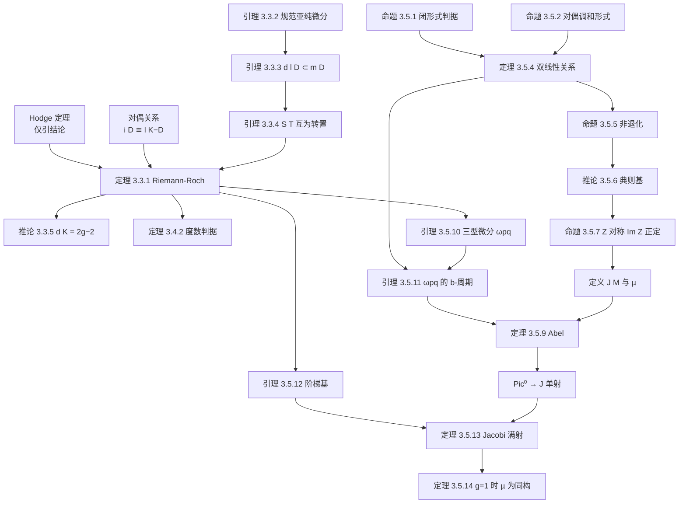

> 本文是《[Abel-Jacobi 与 Riemann-Roch 的证明]()》的注记：主文只留原文陈述与证明，凡是**我加的**东西——逐行依据、引理用途、两条路线的对照、Gu 讲义摘录、依赖图、讹字还原表——都放在这里，按主文的小节顺序排列。

## 0. 分工

| 内容 | 位置 |
|---|---|
| 定理 3.3.1、3.5.4、3.5.9、3.5.13 的陈述与证明（原文照录） | 主文 §2–§5 |
| 记号表 | 主文 §1 |
| 逐行依据、引理用途、跳步说明 | 本文 §1–§4 |
| 链条五环节 | 本文 §1.9 |
| 两条路线（梅加强 / Gu）对照表 | 本文 §2.3、§3.6、§4.3、§5 |
| Gu《CCG Lecture 11》摘录（PAGE 22/25/30/31/43） | 本文 §6 |
| 与《Abel-Jacobi映射》的对应关系 | 本文 §7 |
| 依赖图、OCR 讹字还原表 | 附录 A、附录 B |

**约定**：本文的 `【补】` 全部是我的补充，不属于原文；引用的「主文 §2.6 情形 (1)」指主文里定理 3.3.1 证明的第一种情形。

## 1. Riemann-Roch：逐行依据

### 1.1 陈述：两式为何等价

主文 §2.1 给了两个式子：
$$
\dim l(D)=\dim i(D)+d(D)+(1-g),\qquad \dim l(D)-\dim l(K-D)=d(D)+(1-g).
$$
**【补】** 等价性靠对偶关系 $i(D)\cong l(K-D)$（本文只引用结论，不证）：$\dim i(D)=\dim l(K-D)$，代入第一式即得第二式。主文直接证第一式。

### 1.2 引理 3.3.2：做什么、用在哪

**【补】** 功能：把「任意极点的亚纯微分」标准化为「只在一个点有指定主部、且与全纯微分正交」的规范形。减去全纯微分不破坏 $1/z^n$ 的主部；正交化则让 $\{\tau^k_{p_i}\}$ 张成与 $d(l(D))$ 对偶的显式空间 $m(D)$。

**用途**：主文 §2.4 造 $m(D)$ 的基（从而 $\dim m(D)=d(D)$），进而 §2.5 定义 $S,T$、§2.6 情形 (1) 的第 4 行。

### 1.3 引理 3.3.3：一个跳步

**【补】** (ii) 的「$\Rightarrow$」里，$\int_M\tau\wedge\phi_i=0$ 只对 $g$ 个基成立，凭什么推出「对任意 $\phi\in H^1$」成立？因为 $H^1$（调和形式空间）与 $H$（全纯形式）在同维数下由双线性关系配对非退化——这正是主文 §3 的内容，此处原文按叙述顺序先用了。

**用途**：主文 §2.4 末的 Riemann 不等式 $\dim l(D)\ge 1+d(D)-g$，以及 §2.6 情形 (1) 第 2 行的 $\mathrm{Ker}\,d=\mathbb C$、$\mathrm{Im}\,d=d(l(D))$。

### 1.4 引理 3.3.4：为什么是枢纽

**【补】** 它把「$\mathrm{Im}\,d$ 的维数」这个难算的量，换成了「$T$ 的秩」；而 $T$ 的核恰好是被 $D$ 压住的全纯微分，即 $i(D)$。于是 RR 退化为一次秩-零化度计算。

**用途**：主文 §2.6 情形 (1) 的第 2 行 ((i))、第 4 行 ((iii))、第 6 行 ((ii))；情形 (2)(3) 只是代入后做代数整理。

### 1.5 情形 (1) 的逐行依据

主文 §2.6 的那个七行等式，逐行来源是：

| 行 | 依据 |
|---|---|
| 第 2 行 $\dim l(D)=1+\dim\mathrm{Ker}\,S$ | 引理 3.3.4(i) $\mathrm{Ker}\,S=\mathrm{Im}\,d$ |
| 第 3 行 $\dim m(D)=\dim\mathrm{Ker}\,S+\dim\mathrm{Im}\,S$ | 秩-零化度公式 |
| 第 4 行 $=1+d(D)-\dim\mathrm{Im}\,T$ | 引理 3.3.4(iii) 与 $\dim m(D)=d(D)$ |
| 第 5 行 $\dim\mathrm{Im}\,T=\dim H-\dim\mathrm{Ker}\,T$ | 对 $T$ 用秩-零化度 |
| 第 6 行 $=1+d(D)-(g-\dim i(D))$ | 引理 3.3.4(ii) 与 $\dim H=g$ |

另外 $D=0$ 的子情形：$\dim i(0)=g$，故 $g+(1-g)+0=1$。

### 1.6 情形 (2) 的代数验算

**【补】** 把 $d(K-D)=2g-2-d(D)$ 代入主文 §2.6 的式子：
$$
\dim i(D)=\dim l(D)+2g-2-d(D)+1-g=\dim l(D)+(g-1)-d(D),
$$
移项即得 RR。这里用到对偶关系 $i(D)\cong l(K-D)$、$l(D)\cong i(K-D)$ 与 $d(K)=2g-2$（主文 §2.7）。原文此处先用后证，但推论 3.3.5 只用情形 (1) 与 $g\ge1$ 时 $H\neq0$，故逻辑无循环。

### 1.7 情形 (3) 的三个跳步

**【补】**
1. $\dim l(D_1)\le\dim l(D_1-D_2)+d(D_2)$：$l(D_1-D_2)\subseteq l(D_1)$，两者相差 $d(D_2)$ 个线性约束，故每加一个点维数至多涨 1；又 $l(D)=l(D_1-D_2)=\{0\}$，右边化为 $d(D_2)$。
2. 把 $D$ 换成 $K-D$ 得 $d(K-D)\le g-1$，即 $2g-2-d(D)\le g-1$，于是 $d(D)\ge g-1$。
3. 三种子情形覆盖全部 $D$：$l(D)\neq0$、$i(D)\neq0$、两者皆零（此时度数被迫为 $g-1$，两边同为 $0$）。

### 1.8 推论 3.3.5 与定理 3.4.2

**【补】** $l(K)\cong i(0)$、$i(K)\cong l(0)$ 都是对偶关系 $i(D)\cong l(K-D)$ 的特例：$i(0)=H$（无非负性约束的全纯微分全体），$l(0)=\mathbb C$（无极点约束的全纯函数只能是常数）。

定理 3.4.2(i) 是实用判据：**度数足够大时，「维数 = 度数 + 1 − 亏格」，与曲面形状无关**。这正是主文里「Riemann-Roch 只管有多少解」的确切含义——它给的是解空间维数，不是解是否存在。

### 1.9 链条五环节

| 环节 | 内容 | 依据 |
|---|---|---|
| ① | 造出 $m(D)$ 的显式基 $\{\tau^k_{p_i}\}$，$\dim m(D)=d(D)$ | 引理 3.3.2 |
| ② | $df\in m(D)$ 对 $f\in l(D)$ 成立，且 $\mathrm{Ker}\,d=\mathbb C$ | 引理 3.3.3 |
| ③ | $\mathrm{Im}\,d$ 的余维数等于 $\dim i(D)$（$S$、$T$ 互为转置） | 引理 3.3.4 |
| ④ | 秩-零化度收口：$\dim l(D)=1+d(D)-\dim i(D)$ | 秩-零化度公式 |
| ⑤ | 从有效因子推到一般因子 | 主文 §2.6 情形 (2)、(3) |

## 2. 双线性关系：节点与对照

### 2.1 命题 3.5.2 的构造

**【补】** 证明是构造性的：把 $\sigma$ 分成小段 $[t_{j-1},t_j]$，在坐标圆盘 $D_j$ 内用亚纯函数 $\frac{z-z(\sigma(t_j))}{z-z(\sigma(t_{j-1}))}$ 与截断函数 $\psi_j$ 拼出光滑函数 $f_j$，令 $f=f_1f_2\cdots f_n$，再对 $df$ 作 Hodge 分解取调和部分。原文该构造约占两页，未重排，可对照原书 p.108–110。

### 2.2 证明的四个节点

**节点 3.3-①** 已知：$\omega$ 全纯、$M_0$ 单连通。依据：命题 3.5.1。得到：$I(p)=\int_{p_0}^{p}\omega$ 与路径无关，$dI=\omega$。

**节点 3.3-②** (3.6) 是把围道积分换成留数。注意 $\mathrm{Res}_{p_j}(I\eta)=\mathrm{Res}_{p_j}(\eta)\cdot I(p_j)$，因为 $I$ 在 $p_j$ 附近全纯且 $I(p_j)=\int_{p_0}^{p_j}\omega$。

**节点 3.3-③** 差值为何恰为 $-\Pi_{g+i}$：$z$ 与 $z'$ 是基本多边形 $P$ 上被黏合的两点，走 $z'\to z$ 等价于沿 $\sigma_{g+i}$ 绕一圈，故 $I(z)-I(z')=-\int_{\sigma_{g+i}}\omega$；符号由相交数 $\sigma_i\cdot\sigma_{g+i}=1$ 的定向决定。

**节点 3.3-④** 关键合并：$\partial M_0$ 由 $4g$ 条边组成，成对出现 $(\sigma_i,\sigma_i')$ 与 $(\sigma_{g+i},\sigma_{g+i}')$；$g$ 个 $i$ 各贡献 $\Pi_iN_{g+i}$ 与 $-\Pi_{g+i}N_i$，求和即 (3.7)。边界两种算法相等，即得双线性关系。

### 2.3 路线对照

| 栏目 | 路线 A（梅加强，主文照录） | 路线 B（Gu, PAGE 22–25） |
|---|---|---|
| 陈述形态 | 带残数项：$\sum(\Pi_iN_{g+i}-\Pi_{g+i}N_i)=2\pi\sqrt{-1}\sum\mathrm{Res}_{p_j}(\eta)\int_{p_0}^{p_j}\omega$ | 取 $\eta=\omega_j$ 全纯，残数项消失，得 $AB^{\mathsf T}=BA^{\mathsf T}$ 与 Hermite 正定 |
| 关键一步 | 边界两种算法相等（留数 vs 基本多边形） | 直接对 $\int_M\omega_i\wedge\bar\omega_j$ 计算 |
| 结论强度 | 更强（含残数） | 更弱但更易数值验证 |
| 可计算性 | 中 | 高（周期矩阵的数值判据） |

## 3. Abel 定理：校勘与节点

### 3.1 命题 3.5.7 的「实部 / 虚部」

**【补】** 原书标题写「实部」，但推导得到的是 $\mathrm{Im}\,Z$ 正定——按原文计算，正确表述应为「**虚部**正定对称」。这与 Gu 讲义 PAGE 25 的 $\mathrm{Im}(Z)>0$ 一致。主文照录原文措辞，此处标注该差异（原书疑为笔误）。

### 3.2 $\mu$ 的良定义性

**【补】** 来自命题 3.5.1：两条路径之差是一条闭曲线，沿闭曲线积分为周期，恰属格点群 $\mathrm{Im}\,\varphi$，故在商空间里被抹掉。

### 3.3 引理 3.5.10：一处笔误与 RR 的用法

**【补】** 这是 RR 的直接应用：$d(-p-q)=-2$，代入得 $\dim i(-p-q)=g+1$，比全纯微分的 $g$ 维多一维，多出来的正是「带两个简单极点」的三型微分。剩余部分（差一个全纯微分，用基的正交性把 $\int_{\sigma_i}$ 调成 $0$）与引理 3.3.2 同一手法。

另需注意：原文「显然 $l(-p-q)=H$」应为笔误。按定义 $l(-p-q)=\{f:(f)-p-q\ge0\}=\{0\}$（既无极点又在 $p,q$ 处为零的全纯函数只能是零），故 $\dim l(-p-q)=0$；而 $H=\{(\omega)\ge0\}$ 是 $\dim g$ 的全纯微分空间，它落在 $i(-p-q)=\{(\omega)+p+q\ge0\}$ 里。只有把左端的 $0$ 读作 $\dim l(-p-q)$，才能推出 $\dim i(-p-q)=g+1$。

### 3.4 引理 3.5.11：核心桥

**【补】** 左端第二个因子为零，正是因为引理 3.5.10(2) 把 $\int_{\sigma_j}\omega_{pq}$（$j\le g$）全调成了 $0$——这就是那条「多余条件」的用处。这一步把拓扑量 $\int_{\sigma_{g+i}}\omega_{pq}$ 换算成几何量 $\int_q^p\omega_i$，是 Abel 定理证明的核心桥。

### 3.5 定理 3.5.9 的五个节点

**必要性**

- **节点 4.4-①** 已知：$f$ 亚纯，$df/f$ 的留数即 $\nu_p(f)$，全为整数。依据：留数定理。得到：沿任一闭曲线的周期是 $2\pi\sqrt{-1}$ 的整数倍，即 $\alpha_i\in\mathbb Z$。
- **节点 4.4-②** 用到典范基的归一化 $\int_{\sigma_i}\omega_j=\delta_{ij}$（推论 3.5.6）：正因如此，$c_i$ 可以直接读出，无需解线性方程组。
- **节点 4.4-③** 为什么整数系数意味着落在格点群里：$J(M)=H^{*}/\mathrm{Im}\,\varphi$，而 $\mathrm{Im}\,\varphi$ 由所有闭曲线的积分泛函生成，$\sum\beta_j\int_{\sigma_j}$ 正是其中元素；系数为整数 ⟹ $\mu(D)\in\mathrm{Im}\,\varphi$ ⟹ 商空间里为 $0$。

**充分性**

- **节点 4.4-④** 两个周期式的来源：第一式用 $\int_{\sigma_i}\omega_{p_jq_j}=0$（引理 3.5.10(2)）；第二式用 $\int_{\sigma_{g+i}}\omega_{p_jq_j}=2\pi\sqrt{-1}\int_{q_j}^{p_j}\omega_i$（引理 3.5.11）以及 $\mu(D)=0$ 给出的整数关系。
- **节点 4.4-⑤** 最后三件事同时到位：① 良定义——沿不同路径差一个 $2\pi\sqrt{-1}\mathbb Z$ 的周期，取指数后单值；② 亚纯——$\eta$ 只有单极点且残数为整数，积分后取指数即得零点/极点；③ 除子——$\eta=\frac{df}{f}$，故 $\mathrm{Res}_{p_j}\eta=\nu_{p_j}(f)=+1$、$\mathrm{Res}_{q_j}\eta=\nu_{q_j}(f)=-1$，于是 $(f)=\sum(p_j-q_j)=D$。

### 3.6 路线对照

| 栏目 | 路线 A（梅加强，主文照录） | 路线 B（Gu, PAGE 30–31, 43–44） |
|---|---|---|
| 陈述形态 | $d(D)=0$ 且 $\mu(D)=0\iff D$ 为主因子 | 正合列 $K^{*}(C)\to\mathrm{Div}^0(C)\xrightarrow{\mu}J(C)\to 0$，即 $\mathrm{Img}(\ )=\mathrm{Ker}\,\mu$ 且 $\mu$ 满射；进而 $\mathrm{Pic}(C)\cong J(C)$ |
| 核心工具 | 三型微分 $\omega_{pq}$ + 双线性关系把周期换成积分 | 三型微分 + 周期矩阵归一化 $(I\ Z)$ |
| 关键一步 | 引理 3.5.11：$\int_{\sigma_{g+i}}\omega_{pq}=2\pi\sqrt{-1}\int_q^p\omega_i$ | 由 $\mu(D)=0$ 取出整数 $\beta$，构造 $\varphi'=\varphi-\sum\beta_j\omega_j$ 使所有周期为 $2\pi\sqrt{-1}$ 的整数倍，再取指数 |
| 结论强度 | 完整（含 $\alpha_i\in\mathbb Z$ 的推导与良定义性） | 结论等价，步骤压缩为提纲 |
| 可计算性 | 低（需人工找 $\omega_{pq}$） | 高（周期矩阵可数值计算，直接判定 $\mu(D)$ 是否为零） |

## 4. Jacobi 反演：节点与对照

### 4.1 引理 3.5.12 用的是 RR

**【补】** 这里连续用了 $\dim i(p_1+\cdots+p_k)=g-k$，依据仍是 RR（等价于「$k$ 个一般点给全纯微分 $k$ 个独立条件」）。这就是**为什么 RR 是 Jacobi 反演的引擎**：没有维数估计，就取不到这组「阶梯状」的基。

### 4.2 定理 3.5.13 的两个节点

- **节点 5.2-①** 为什么 $\dim l(D_1)\ge1$ 就够：$l(D_1)\neq\{0\}$ 意味存在非零亚纯函数，其除子 $(f)\ge -D_1$，于是 $(f)+D_1$ 是有效因子；它的度数为 $d(D_1)=g$，而「$g$ 次有效因子 = $g$ 个点之和」，正是 $\Psi$ 像的形状。
- **节点 5.2-②** 三步收口：单射（Abel 定理）→ 局部满射（逆映射定理 + Jacobi 矩阵非退化，后者由引理 3.5.12 保证）→ 连通性（$M^g$ 连通、$J(M)$ 是复环面）⟹ 满射 ⟹ 同构。

### 4.3 路线对照

| 栏目 | 路线 A（梅加强，主文照录） | 路线 B（Gu, PAGE 31） |
|---|---|---|
| 陈述形态 | $\Psi$ 满射 + $j$ 同构 ⟹ $J$ 满射 | 「$\mu$ 诱导同构 $\mathrm{Pic}(C)\to J(C)$」一句带过 |
| 关键一步 | 引理 3.5.12 的阶梯基 + 逆映射定理 | 由 Abel 定理得单射，由 $\dim$ 计数与开映射性得满射 |
| 依赖 | RR（两次：$\dim l(D_1)\ge1$、$\dim i(p_1+\cdots+p_k)=g-k$） | RR（用于同维数与满射性） |
| 结论强度 | 完整证明 | 结论等价，证明省略 |
| 可计算性 | 低 | 高（$\Psi$ 的数值实现即「求 $g$ 个点使除子等价」） |

**交汇点**：RR 给出「维数够用」，Abel 给出「核为 0」，逆映射定理给出「像是开的」——三者合成 $\mathrm{Pic}^0(M)\cong J(M)$。

## 5. 两条路线总览

| | 路线 A：复分析 / Hodge 理论 | 路线 B：几何 / 拓扑 |
|---|---|---|
| 出处 | 梅加强《黎曼曲面导引》§3.3、§3.5 | 顾险峰《Computational Conformal Geometry》Lecture 11 |
| 出发点 | 亚纯微分、留数、奇异积分 | 闭曲线、相交数、周期矩阵 |
| 核心工具 | Hodge 定理、留数定理、对偶关系 $i(D)\cong l(K-D)$ | 双线性关系、Abel–Jacobi 映射、逆映射定理 |
| RR 的形态 | $\dim l(D)=\dim i(D)+d(D)+(1-g)$，用 $S$、$T$ 两个互为转置的算子 | 与 A 同式，但用 $\dim l(-D)=\dim i(D)+d(D)+1-g$ 直接调用 |
| Abel 的形态 | $\deg D=0$ 且 $\mu(D)=0\iff D$ 为主除子，用 $\omega_{pq}$ 的周期公式 | 正合列 $0\to\mathrm{Div}^0/\mathrm{Img}\to J(C)\to 0$、$\mathrm{Pic}(C)\cong J(C)$ |
| 结论强度 | 完整证明，含所有技术细节 | 结论等价，部分步骤以「可以证明」带过 |
| 可计算性 | 以存在性为主 | 直接给出周期矩阵的数值判据（可落到算法） |

**两条路线共用**：周期矩阵、双线性关系、$\mu$ 的定义。
**两条路线分歧**：A 从「奇异积分 + 算子转置」直接算维数；B 从「周期矩阵的 Hermite 正定性 + 逆映射定理」直接得满射性。
**交汇点**：都落在同一个量 $\ell(D)-\ell(K-D)$ 上；Abel 定理与 Jacobi 反演合起来就是 $\mathrm{Pic}^0(M)\cong J(M)$。

## 6. Gu 讲义摘录（按 PAGE 序）

以下按原 PDF 页码照录，供与路线 A 对照。

**PAGE 22（Period Matrix 定理）**

> **Theorem (Period Matrix).** Suppose $C$ is a compact Riemann surface, the period matrix $\Pi$ under a canonical basis of $H_1(C,\mathbb Z)$ and a basis of $\Omega^1(C)$ is $\Pi_{g\times 2g}=(A_{g\times g},B_{g\times g})$, then we have
> 1. $AB^{\mathsf T}=BA^{\mathsf T}$;
> 2. $\sqrt{-1}(A\bar B^{\mathsf T}-B\bar A^{\mathsf T})$ is a Hermite positive definite matrix.

**PAGE 25（归一化周期矩阵）**

> We can change the basis of $\Omega^1(C)$ by $A^{-\mathsf T}$ to obtain the normalized period matrix $\Pi=(I_g\ Z)$, then the Riemann bilinear relation becomes
> 1. $Z=Z^{\mathsf T}$;
> 2. the imaginary part of $Z$, $\mathrm{Img}(Z)$, is a real positive definite matrix.

**PAGE 30（Abel–Jacobi 正合列）**

> $$
> K^{*}(C)\longrightarrow\mathrm{Div}^0(C)\xrightarrow{\mu}J(C)\longrightarrow 0
> $$
> is exact, namely $\mathrm{Img}(\ )=\mathrm{Ker}\,\mu$ and $\mu$ is surjective.

**PAGE 31（Picard 簇与 Abel 定理）**

> **Definition (Picard variety).** The quotient group $\mathrm{Pic}(C):=\mathrm{Div}^0(C)/\mathrm{Img}(\ )$ is called the Picard variety of $C$.
>
> **Theorem (Abel).** The Abel–Jacobi map $\mu$ induces an isomorphism $\mathrm{Pic}(C)\xrightarrow{\sim}J(C)$.

**PAGE 43（三型微分）**

> **Definition (Abelian Differential of The Third Kind).** If $\varphi\in K^1(C)$ has at most simple poles, then $\varphi$ is called a third type of differential. For any $p,q\in C$, $p\neq q$, $\varphi=\varphi_{pq}\in K^1(C)$ is called a third type of elementary differential, if $(\varphi)_\infty=p+q$ and $\mathrm{Res}_p\varphi=\frac{1}{2\sqrt{-1}\pi}$, $\mathrm{Res}_q\varphi=-\frac{1}{2\sqrt{-1}\pi}$.
>
> **Theorem (Existence of Abelian Differential of the Third Kind).** For any $p,q\in C$, $p\neq q$, there is a normal Abelian differential of the third kind $\varphi_{pq}\in K^1(C)$, such that $(\varphi)_\infty=p+q$ and $\mathrm{Res}_p\varphi=(2\sqrt{-1}\pi)^{-1}$, $\mathrm{Res}_q\varphi=-(2\sqrt{-1}\pi)^{-1}$.
>
> **Proof.** Set the divisor $D=-p-q$, then by Riemann-Roch formula
> $$
> \dim l(-D)=\dim i(D)+d(D)+1-g.
> $$
> $-D\ge 0$, so $f\in l(-D)$ must be holomorphic, therefore $f\equiv\mathrm{const}$, $(f)=0$, hence $\dim l(-D)=0$. Therefore $0=\dim i(D)-2+1-g\implies \dim i(D)=g+1$. Therefore we can pick $\omega\in i(D)$, then $\omega$ has poles at $p$ and $q$ only.

**【补】两处记号差异（对照时注意）**
1. 残数归一化不同：梅加强的 $\omega_{pq}$ 取残数 $\pm1$；Gu 取 $\pm\frac{1}{2\pi\sqrt{-1}}$。两者相差常数因子 $2\pi\sqrt{-1}$，故周期公式的写法也不同。
2. RR 的写法不同：Gu 写成 $\dim l(-D)=\dim i(D)+d(D)+1-g$，与梅加强的 $\dim l(D)=\dim i(D)+d(D)+(1-g)$ 是同一个式子，只是把 $D$ 换成 $-D$ 并把 $d$ 显式写出。

## 7. 与《Abel-Jacobi映射》的对应关系

| 主文段落 | 本文/主文的定理 | 主文里用它做什么 |
|---|---|---|
| §除子与 Riemann-Roch 定理 / Riemann-Roch | 定理 3.3.1、定理 3.4.2 | 「维数 = 度数 + 1 − 亏格」的判据，回答「有多少解」 |
| §周期矩阵与 Jacobi 簇 | 命题 3.5.7（$Z$ 对称、$\mathrm{Im}\,Z$ 正定）、PAGE 22/25 | 周期矩阵 $\Pi$ 的两条基本性质 |
| §Abel–Jacobi 映射 / Abel 定理 | 定理 3.5.9 | $\mu(D)=0$ 的充要性，以及为何须先减去 $4K$ 使次数归零 |
| §四边形网格与亚纯四次微分 | 定理 3.3.1 + 定理 3.5.9 | $D_Q$ 的度数 $8g-8$ 与典范度数恒等（RR 不管这个），存在性由 Abel–Jacobi 条件决定 |
| §示例（环面上无 5,7-三角化） | 定理 3.5.9 + 定理 3.5.14 | 亏格 1 时 $\mu$ 是同构，$\mu(p)=\mu(q)\Rightarrow p=q$ |
| 结论段 | 定理 3.5.13 | 「除子类 ↔ Jacobian 上的点」是一一对应，故 $\mu(D-4K)=0$ 之后一定存在 $\omega$ |

## 附录 A：依赖图

> 图中标「仅引结论」的两个节点（Hodge 定理、对偶关系 $i(D)\cong l(K-D)$）未展开证明：Hodge 定理属原书第三章前两节，对偶关系属第四章，均超出抽录范围。

## 附录 B：OCR 讹字还原表

| OCR 原样 | 还原 | OCR 原样 | 还原 |
|---|---|---|---|
| `lpDq` | $l(D)$ | `ipDq` | $i(D)$ |
| `dpDq` | $d(D)$ | `RpDq` | $R(D)$ |
| `‰` | $\neq$ | `ď` | $\le$ |
| `ě` | $\ge$ | `“` | $=$ |
| `´` | $-$ | `P` | $\in$ |
| `t u` | $\{\}$ | `p1q` | $(1)$ |
| `¨ ¨ ¨` | $\cdots$ | `ϕ` | $\phi$ |
| `?`（在 $\sqrt{\ }$ 语境） | $\sqrt{-1}$ | `x3.3` | §3.3 |
| `Kerd` | $\mathrm{Ker}\,d$ | `ImpDq` | $\mathrm{Im}\,d$ |
