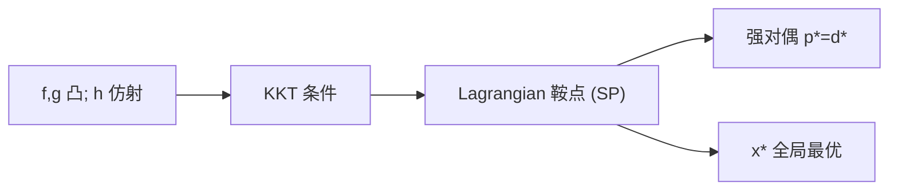

## 对偶理论

**原问题**最优值记 $p^* := \min\{f(\boldsymbol{x}): h=0,\, g\le 0\}$。

引入 Lagrange 乘子 $\boldsymbol{\lambda}\in\mathbb{R}^m$（等式）与 $\boldsymbol{\mu}\in\mathbb{R}^p$（不等式），构造 **Lagrangian**
$$
\mathcal{L}(\boldsymbol{x},\boldsymbol{\lambda},\boldsymbol{\mu})
= f(\boldsymbol{x}) + \boldsymbol{\lambda}^T\boldsymbol{h}(\boldsymbol{x}) + \boldsymbol{\mu}^T\boldsymbol{g}(\boldsymbol{x}).
$$

对偶理论不先假设 KKT，而是从 Lagrangian 对 $\boldsymbol{x}$ 取下确界出发。

### 对偶函数与对偶问题

定义**对偶函数**

$$
\theta(\boldsymbol{\lambda},\boldsymbol{\mu})
= \inf_{\boldsymbol{x}\in\mathbb{R}^n}\;
\mathcal{L}(\boldsymbol{x},\boldsymbol{\lambda},\boldsymbol{\mu}),
\qquad \boldsymbol{\mu}\ge \boldsymbol{0}.
$$

**对偶问题 (dual)** 为

$$
d^* := \max_{\boldsymbol{\lambda},\,\boldsymbol{\mu}\ge\boldsymbol{0}}\;
\theta(\boldsymbol{\lambda},\boldsymbol{\mu}).
$$

**对偶问题恒为凸优化**——无论原问题是否凸。理由如下：固定 $\boldsymbol{x}$ 时，$\mathcal{L}(\boldsymbol{x},\boldsymbol{\lambda},\boldsymbol{\mu})=f(\boldsymbol{x})+\boldsymbol{\lambda}^T\boldsymbol{h}(\boldsymbol{x})+\boldsymbol{\mu}^T\boldsymbol{g}(\boldsymbol{x})$ 对 $(\boldsymbol{\lambda},\boldsymbol{\mu})$ **仿射**（系数为 $\boldsymbol{h}(\boldsymbol{x})$、$\boldsymbol{g}(\boldsymbol{x})$）。对偶函数

$$
\theta(\boldsymbol{\lambda},\boldsymbol{\mu})=\inf_{\boldsymbol{x}}\mathcal{L}(\boldsymbol{x},\boldsymbol{\lambda},\boldsymbol{\mu})
$$

是一族仿射函数的**逐点下确界**，故 $\theta$ 对 $(\boldsymbol{\lambda},\boldsymbol{\mu})$ **凹**。对偶问题即在凸集 $\{(\boldsymbol{\lambda},\boldsymbol{\mu}):\boldsymbol{\mu}\ge\boldsymbol{0}\}$ 上**极大化凹函数**——等价于极小化凸函数 $-\theta$，属于标准凸优化。

| | **原问题 (primal)** | **对偶问题 (dual)** |
|--|---------------------|---------------------|
| 形式 | $\min f(\boldsymbol{x})$ s.t. 约束 | $\max \theta(\boldsymbol{\lambda},\boldsymbol{\mu})$ s.t. $\boldsymbol{\mu}\ge\boldsymbol{0}$ |
| 凸性 | 一般**非凸**（除非 $f$、$g_j$ 凸且 $h_i$ 仿射） | **恒凸**（$\theta$ 凹 + 可行域凸） |
| 难点 | 可行域可能非凸、多局部极小 | $\theta$ 的显式计算常难（内层 $\inf_{\boldsymbol{x}}$ 可能无闭式） |

因此：原问题非凸时，对偶仍给出**凸**的松弛/下界问题（弱对偶 $d^*\le p^*$），但 $d^*$ 未必等于 $p^*$——间隙大小取决于原问题结构（Slater 等条件保证强对偶）。对偶的凸性不意味着「好算」：求 $\theta(\boldsymbol{\lambda},\boldsymbol{\mu})$ 本身可能需解一个（一般非凸的）内层极小化。

### 弱对偶

对任意**原问题可行** $\boldsymbol{x}$ 与任意 $(\boldsymbol{\lambda},\boldsymbol{\mu}\ge\boldsymbol{0})$，有

$$
\mathcal{L}(\boldsymbol{x},\boldsymbol{\lambda},\boldsymbol{\mu})
= f(\boldsymbol{x}) + \underbrace{\boldsymbol{\lambda}^T\boldsymbol{h}(\boldsymbol{x})}_{=0}
+ \underbrace{\boldsymbol{\mu}^T\boldsymbol{g}(\boldsymbol{x})}_{\le 0}
\;\le\; f(\boldsymbol{x}).
$$

故 $\theta(\boldsymbol{\lambda},\boldsymbol{\mu})\le f(\boldsymbol{x})$。对一切可行 $\boldsymbol{x}$ 取最小，得到**弱对偶 (weak duality)**：

$$
d^* \le p^*
$$

最小化原问题时，对偶最优值 $d^*$ 是原问题最优值 $p^*$ 的一个**下界**。一般非凸问题中，这个下界往往不紧。

**对偶间隙 (duality gap)** 定义为

$$
\mathrm{gap} := p^* - d^* \;\ge\; 0.
$$

弱对偶还有一层几何读法：把 Lagrangian 看成双变量函数，$d^*\le p^*$ 就是 minimax 不等式；它与 KKT 充分性共用「鞍点」这一个概念。为了不打断对偶理论的主线，这部分统一放到文末附录 A.1。

### 经济学视角：$d^*$ 是「可证明的最优成本下界」

在资源约束优化里，可把原问题读作**生产者问题**：

$$
p^* = \min\;\text{成本（或损失）} f(\boldsymbol{x})
\quad\text{s.t.}\quad
\text{资源/技术约束 } h=0,\; g\le 0.
$$

- **$\boldsymbol{x}$**：生产方案（投入、参数、映射坐标等）；
- **$g_j(\boldsymbol{x})\le 0$**：第 $j$ 种资源的上限或规范（面积、能量、容量）；
- **$p^*$**：在约束下能实现的**最低可行成本**。

**对偶问题**换一个提问方式：不直接找最优方案，而是问——「若允许对违反约束施加**线性惩罚**（由 $\boldsymbol{\mu}\ge 0$ 定价），再让生产者自由选 $\boldsymbol{x}$ 使 Lagrangian 最小，惩罚定价 $\boldsymbol{\mu}$ 最多能把成本**压到多低**？」

$$
d^* = \max_{\boldsymbol{\mu}\ge 0}\;
\underbrace{\inf_{\boldsymbol{x}}\bigl(f(\boldsymbol{x})+\boldsymbol{\mu}^T\boldsymbol{g}(\boldsymbol{x})\bigr)}_{\text{给定价格后，生产者的最优反应}}.
$$

- **$\mu_j$**：第 $j$ 种约束的**影子价格 (shadow price)**——资源每放松一单位，最优成本可下降多少（见后文互补松弛）；
- **$\theta(\boldsymbol{\mu})$**：在价格 $\boldsymbol{\mu}$ 下，生产者按 $\min_{\boldsymbol{x}}\mathcal{L}$ 反应后的**最低广义成本**；
- **$d^*$**：所有合理定价 $\boldsymbol{\mu}\ge 0$ 中，这个下界的**最大值**。

因此 $d^*\le p^*$ 有清晰的经济含义：

> **无论你怎么给约束标定惩罚价，按 Lagrangian 自由优化后得到的成本下界，都不可能超过真正受约束时的最优成本 $p^*$。**

- 若 $d^*<p^*$：**对偶间隙**表示「仅靠线性惩罚无法完全替代硬约束」——惩罚定价再精明，生产者的最优反应仍比真约束下更乐观，下界偏松。
- 若 $d^*=p^*$（强对偶）：存在价格 $\boldsymbol{\mu}^*$，使「软约束 + 该定价」与「硬约束」给出相同最优值；$\mu_j^*$ 即约束 $j$ 的**边际价值**——紧约束处 $\mu_j^*>0$，松弛约束处 $\mu_j^*=0$（多一单位资源已不值钱）。

**小例子（单资源）**：$\min x$ s.t. $x\ge 2$（等价于 $2-x\le 0$）。真约束下 $p^*=2$。若用惩罚 $\mu(2-x)$ 代替约束，生产者会取 $x\to -\infty$ 使 $\mathcal{L}=x+\mu(2-x)\to -\infty$（$\mu\ne 1$），或 $\mathcal{L}\equiv 2$（$\mu=1$）。故 $d^*=\max_{\mu\ge 0}\inf_x \mathcal{L}=2=p^*$：价格 $\mu^*=1$ 恰为「每少生产一单位 $x$ 所节省的边际成本」，与约束边际一致。

**与 LP 单纯形法**：最优表最后一行的**检验数**即对偶变量；它们既是 KKT 乘子，也是资源的影子价格——这是 $d^*\le p^*$ 在运筹学里每天被「算出来」的版本。

### 强对偶

若 $\mathrm{gap}=0$，即 $p^*=d^*$，称**强对偶 (strong duality)** 成立：原问题与对偶问题最优值一致。此时求解原问题等价于寻找使间隙为零的 $(\boldsymbol{x}^*,\boldsymbol{\lambda}^*,\boldsymbol{\mu}^*)$；**内点法**与**增广拉格朗日法**可理解为从不同路径逼近这一状态。

强对偶并非恒成立。常见充分条件：

| 条件 | 说明 |
|------|------|
| **凸 + Slater** | $f$、$g_j$ 凸，$h_i$ 仿射，且 Slater 条件成立（见下节） |
| **线性规划** | 若原问题或其对偶之一有有限最优值，则双方最优值相等 |
| **凸 QP**（$\boldsymbol{H}\succeq 0$） | Slater 的特例 |

整数规划中的 **LP 松弛**给出 $z_{\mathrm{LP}}\le z_{\mathrm{IP}}$，可视为离散问题上的「弱对偶下界」；**整数性间隙**与连续凸优化中的对偶间隙扮演类似角色——衡量松弛有多紧。

## KKT 条件

在对偶理论与 Slater 条件铺垫之后，**Karush–Kuhn–Tucker (KKT) 条件**给出最优解处 $\boldsymbol{x}^*$ 与乘子 $(\boldsymbol{\lambda}^*,\boldsymbol{\mu}^*)$ 应满足的代数关系。

在 $\boldsymbol{x}^*$ 处满足 **LICQ** 等约束品性时，若 $\boldsymbol{x}^*$ 为**局部最优**，则存在乘子使

$$
\boxed{
\begin{aligned}
&\text{（平稳性）}\quad
\nabla_{\boldsymbol{x}} \mathcal{L}(\boldsymbol{x}^*,\boldsymbol{\lambda}^*,\boldsymbol{\mu}^*) = 0 \\[4pt]
&\text{（原始可行性）}\quad
h_i(\boldsymbol{x}^*)=0,\;\; g_j(\boldsymbol{x}^*)\le 0 \\[4pt]
&\text{（对偶可行性）}\quad \mu_j^* \ge 0 \\[4pt]
&\text{（互补松弛）}\quad
\mu_j^*\, g_j(\boldsymbol{x}^*) = 0,\quad j=1,\ldots,p
\end{aligned}
}
$$

一般非凸问题中，KKT 只是**必要条件**：满足 **KKT 的点可能是鞍点，未必是局部最优**

### 充分性与 Slater 条件

弱对偶 $d^*\le p^*$ 恒成立。下面先分清两个方向；充分性的证明放在文末附录 A.2（用鞍点定理，只用到凸性）。

| 方向 | 所需条件 | 结论 |
| :--- | :--- | :--- |
| **充分性** | $f$、$g_j$ 凸，$h_i$ 仿射；$(\boldsymbol{x}^*,\boldsymbol{\lambda}^*,\boldsymbol{\mu}^*)$ 满足 KKT | $\boldsymbol{x}^*$ 为**全局最优**（**不必** Slater） |
| **必要性** | 同上 + **Slater**；$\boldsymbol{x}^*$ 为全局最优 | 存在乘子使 KKT 成立；**强对偶** $p^*=d^*$ |

**Slater 条件**：存在可行点 $\boldsymbol{\tilde{x}}$ 使 $h_i(\boldsymbol{\tilde{x}})=0$，且 $g_j(\boldsymbol{\tilde{x}})<0$（不等式严格成立）。仿射不等式可放宽为 $g_j(\boldsymbol{\tilde{x}})\le 0$。直观：可行域在不等式意义下有相对内部；椭圆内、多边形内等通常易验证。

凸 + Slater 时二者合并为等价：

$$
\boldsymbol{x}^* \text{ 满足 KKT} \quad \Longleftrightarrow \quad \boldsymbol{x}^* \text{ 为全局最优},
\qquad p^*=d^*.
$$

充分性的严格证明走「KKT 点 $\Rightarrow$ Lagrangian 鞍点 $\Rightarrow$ 全局最优」这条线，只用到凸性、不用 Slater；完整推导见文末附录 A.2（同处也给出鞍点与强对偶的关系）。

### 互补松弛条件

互补松弛 $\mu_j^*\, g_j(\boldsymbol{x}^*) = 0$ 刻画不等式与乘子的分工。由 $g_j(\boldsymbol{x}^*)\le 0$ 与 $\mu_j^*\ge 0$，每一项 $\mu_j^* g_j(\boldsymbol{x}^*)\le 0$，逐项为零意味着：

| 情形 | 约束状态 | 乘子 | 含义 |
|------|---------|------|------|
| **松弛 (slack)** | $g_j(\boldsymbol{x}^*) < 0$ | $\mu_j^* = 0$ | 约束不紧，去掉它最优解不变 |
| **活跃 (active)** | $g_j(\boldsymbol{x}^*) = 0$ | $\mu_j^* \ge 0$ | 约束紧；$\mu_j^*$ 为**影子价格** |

活跃约束对应 $\mu_j^*\ge 0$，此时 $\mu_j^*$ 称为第 $j$ 条不等式约束的**影子价格 (shadow price)**（亦称**对偶价格**）：它度量**放松该约束一单位时，最优目标值可改善的幅度**。

将约束写为 $g_j(\boldsymbol{x})\le 0$，若将其放松为 $g_j(\boldsymbol{x})\le -\delta$（可行域扩大），对最小化问题最优值 $p^*$ 只能下降或不变。在约束活跃且正则性良好时，一阶灵敏度为

$$
\frac{\mathrm{d} p^*}{\mathrm{d}\delta}\bigg|_{\delta=0} = -\mu_j^*.
$$

即 $\mu_j^*>0$ 表示该约束**紧**地限制了解：边界向外挪一点，目标还能下降 $\mu_j^*$ 那么多。互补松弛保证**仅活跃约束**可有 $\mu_j^*>0$；松弛约束处 $\mu_j^*=0$，因其放松已不改变最优值。

**与对偶问题的关系**：对偶变量 $\boldsymbol{\mu}^*$ 正是 KKT 乘子；强对偶成立时（凸 + Slater），$\mu_j^*$ 同时是对偶最优解的分量，故 LP 单纯形法最优表中的「对偶价格」、MILP 分支定界中的 **LP 松弛界** 都直接读取影子价格。

---

## 附录：鞍点

把 Lagrangian 当作 $\boldsymbol{x}$ 与 $\boldsymbol{\lambda},\boldsymbol{\mu}$ 的双变量函数，「鞍点」是理解两件事的统一语言：一是弱对偶为什么恒成立（A.1），二是凸问题下 KKT 为什么充分（A.2）。

### A.1 鞍点视角：为何恒有 $d^*\le p^*$？

把 Lagrangian 看成 $\boldsymbol{x}$ 与 $(\boldsymbol{\lambda},\boldsymbol{\mu})$ 的**双变量函数**。原问题与对偶问题可写成两个**极值–极值**问题：

$$
\boxed{
p^* = \min_{\boldsymbol{x}\in\mathcal{F}}
\;\max_{\boldsymbol{\lambda},\,\boldsymbol{\mu}\ge\boldsymbol{0}}\;
\mathcal{L}(\boldsymbol{x},\boldsymbol{\lambda},\boldsymbol{\mu})
}
\tag{P}
$$

$$
\boxed{
d^* = \max_{\boldsymbol{\lambda},\,\boldsymbol{\mu}\ge\boldsymbol{0}}
\;\min_{\boldsymbol{x}\in\mathbb{R}^n}\;
\mathcal{L}(\boldsymbol{x},\boldsymbol{\lambda},\boldsymbol{\mu})
}
\tag{D}
$$

这里 $\mathcal{F}=\{\boldsymbol{x}: h=0,\,g\le 0\}$ 为原可行域。对任意函数 $\mathcal{L}$，**minimax 不等式**恒成立：

$$
\max_{\boldsymbol{\lambda},\boldsymbol{\mu}\ge\boldsymbol{0}}
\min_{\boldsymbol{x}}
\mathcal{L}(\boldsymbol{x},\boldsymbol{\lambda},\boldsymbol{\mu})
\;\le\;
\min_{\boldsymbol{x}\in\mathcal{F}}
\max_{\boldsymbol{\lambda},\boldsymbol{\mu}\ge\boldsymbol{0}}
\mathcal{L}(\boldsymbol{x},\boldsymbol{\lambda},\boldsymbol{\mu}),
$$

即 $d^*\le p^*$。证明只需一行交换逻辑：设 $(\boldsymbol{\lambda},\boldsymbol{\mu})$ 为对偶最优，$\boldsymbol{x}$ 为原可行，则

$$
d^* = \min_{\boldsymbol{x}'} \mathcal{L}(\boldsymbol{x}',\boldsymbol{\lambda},\boldsymbol{\mu})
\le \mathcal{L}(\boldsymbol{x},\boldsymbol{\lambda},\boldsymbol{\mu})
\le f(\boldsymbol{x}) \;\Rightarrow\; d^*\le p^*.
$$

**鞍点** $(\boldsymbol{x}^*,\boldsymbol{\lambda}^*,\boldsymbol{\mu}^*)$ 满足：固定乘子时 $\mathcal{L}$ 对 $\boldsymbol{x}$ 极小，固定 $\boldsymbol{x}^*$ 时对乘子极大——即同时实现 (P) 与 (D) 的等号。此时

$$
\mathcal{L}(\boldsymbol{x}^*,\boldsymbol{\lambda}^*,\boldsymbol{\mu}^*)
= p^* = d^*,
$$

**强对偶**等价于 Lagrangian 在最优处存在鞍点。凸 + Slater 保证这种鞍点存在；非凸问题则可能出现「内层 $\min_{\boldsymbol{x}}$ 与外层 $\max$ 换序」后值不相等，留下正的对偶间隙。

**几何直观（$n=1$，单不等式）**：想象 $\mathcal{L}(x,\mu)$ 为曲面。原问题先在每个 $x$ 上对 $\mu\ge 0$ 取**上包络**（惩罚违反约束），再对 $x$ 取最小——得到 $p^*$。对偶问题先对每个 $\mu$ 在 $x$ 上取**下包络**，再对 $\mu$ 取最大——得到 $d^*$。下包络的最高点不可能超过上包络的最低点，故 $d^*\le p^*$。

| 操作顺序 | 含义 | 结果 |
| :--- | :--- | :--- |
| $\min_x \max_\mu \mathcal{L}$ | 先对每个位置选最狠惩罚，再选最优位置 | $p^*$（原问题） |
| $\max_\mu \min_x \mathcal{L}$ | 先对每个惩罚系数找最省成本的 $x$，再选最有利的系数 | $d^*$（对偶问题） |
| 鞍点 | 两种顺序得到同一值 | $p^*=d^*$（强对偶） |

### A.2 鞍点定理证明 KKT 的充分性

**定理（KKT 充分性）.** 设 $f$ 凸、各 $g_j$ 凸、各 $h_i$ 仿射。若 $(\boldsymbol{x}^*,\boldsymbol{\lambda}^*,\boldsymbol{\mu}^*)$ 满足 KKT，则 $\boldsymbol{x}^*$ 为原问题的**全局最优解**，且 $f(\boldsymbol{x}^*)=\mathcal{L}(\boldsymbol{x}^*,\boldsymbol{\lambda}^*,\boldsymbol{\mu}^*)$。

证明核心：在凸性假设下，KKT 点使 Lagrangian 成为**鞍点**；鞍点右侧不等式给出对任意可行 $\boldsymbol{x}$ 的 $f(\boldsymbol{x})\ge f(\boldsymbol{x}^*)$。

#### 鞍点定义与强对偶

回忆 A.1 中的 (P)(D)。点 $(\boldsymbol{x}^*,\boldsymbol{\lambda}^*,\boldsymbol{\mu}^*)$（$\boldsymbol{\mu}^*\ge\boldsymbol{0}$）称为 $\mathcal{L}$ 的**鞍点**，若

$$
\mathcal{L}(\boldsymbol{x}^*,\boldsymbol{\lambda},\boldsymbol{\mu})
\;\le\;
\mathcal{L}(\boldsymbol{x}^*,\boldsymbol{\lambda}^*,\boldsymbol{\mu}^*)
\;\le\;
\mathcal{L}(\boldsymbol{x},\boldsymbol{\lambda}^*,\boldsymbol{\mu}^*),
\qquad
\forall\,\boldsymbol{x},\;\forall\,(\boldsymbol{\lambda},\boldsymbol{\mu}\ge\boldsymbol{0}).
\tag{SP}
$$

**鞍点定理（约束优化版）**：若鞍点存在，则

$$
\mathcal{L}(\boldsymbol{x}^*,\boldsymbol{\lambda}^*,\boldsymbol{\mu}^*)
= p^* = d^*,
$$

即**强对偶**成立，且 $\boldsymbol{x}^*$ 解原问题、$(\boldsymbol{\lambda}^*,\boldsymbol{\mu}^*)$ 解对偶问题。理由：由 (SP) 右半，$\boldsymbol{x}^*$ 最小化 $\mathcal{L}(\cdot,\boldsymbol{\lambda}^*,\boldsymbol{\mu}^*)$，故

$$
d^* \le \theta(\boldsymbol{\lambda}^*,\boldsymbol{\mu}^*)
= \inf_{\boldsymbol{x}}\mathcal{L}(\boldsymbol{x},\boldsymbol{\lambda}^*,\boldsymbol{\mu}^*)
= \mathcal{L}(\boldsymbol{x}^*,\boldsymbol{\lambda}^*,\boldsymbol{\mu}^*);
$$

由 (SP) 左半，对任意原可行 $\boldsymbol{x}$（$h=0,\,g\le 0$），

$$
f(\boldsymbol{x})
= \mathcal{L}(\boldsymbol{x},\boldsymbol{\lambda}^*,\boldsymbol{\mu}^*)
\ge \mathcal{L}(\boldsymbol{x}^*,\boldsymbol{\lambda}^*,\boldsymbol{\mu}^*)
\ge f(\boldsymbol{x}^*),
$$

故 $p^*\ge f(\boldsymbol{x}^*)\ge \mathcal{L}^*$，与 $d^*\le \mathcal{L}^*$ 合并得 $p^*=d^*=\mathcal{L}^*$。

因此：**证 KKT 充分性 $\Leftrightarrow$ 证 KKT 点必是鞍点**（凸情形下）。

#### 第一步：KKT $\Rightarrow$ 鞍点右侧（$\boldsymbol{x}^*$ 最小化 $\mathcal{L}$）

固定 $(\boldsymbol{\lambda}^*,\boldsymbol{\mu}^*)$，记

$$
\phi(\boldsymbol{x})=\mathcal{L}(\boldsymbol{x},\boldsymbol{\lambda}^*,\boldsymbol{\mu}^*)
= f(\boldsymbol{x})+\boldsymbol{\lambda}^{*T}\boldsymbol{h}(\boldsymbol{x})+\boldsymbol{\mu}^{*T}\boldsymbol{g}(\boldsymbol{x}).
$$

$f$ 凸、$g_j$ 凸、$h_i$ 仿射 $\Rightarrow$ $\phi$ 为**凸函数**。KKT **平稳性** $\nabla_{\boldsymbol{x}}\mathcal{L}(\boldsymbol{x}^*,\boldsymbol{\lambda}^*,\boldsymbol{\mu}^*)=\boldsymbol{0}$ 即 $\nabla\phi(\boldsymbol{x}^*)=\boldsymbol{0}$。凸可微函数在梯度为零处取**全局极小**，故

$$
\mathcal{L}(\boldsymbol{x},\boldsymbol{\lambda}^*,\boldsymbol{\mu}^*)
=\phi(\boldsymbol{x})
\ge \phi(\boldsymbol{x}^*)
=\mathcal{L}(\boldsymbol{x}^*,\boldsymbol{\lambda}^*,\boldsymbol{\mu}^*),
\qquad \forall\,\boldsymbol{x}.
$$

这正是 (SP) 的**右半不等式**。

#### 第二步：KKT $\Rightarrow$ 鞍点左侧（对乘子极大）

固定 $\boldsymbol{x}^*$，考察

$$
\psi(\boldsymbol{\lambda},\boldsymbol{\mu})
=\mathcal{L}(\boldsymbol{x}^*,\boldsymbol{\lambda},\boldsymbol{\mu})
= f(\boldsymbol{x}^*)+\boldsymbol{\lambda}^T\boldsymbol{h}(\boldsymbol{x}^*)+\boldsymbol{\mu}^T\boldsymbol{g}(\boldsymbol{x}^*).
$$

**等式约束**：$h_i(\boldsymbol{x}^*)=0$ 使 $\boldsymbol{\lambda}^T\boldsymbol{h}(\boldsymbol{x}^*)=0$，与 $\boldsymbol{\lambda}$ 无关。

**不等式部分**：记 $\Delta\boldsymbol{\mu}=\boldsymbol{\mu}-\boldsymbol{\mu}^*$，则

$$
\psi(\boldsymbol{\lambda},\boldsymbol{\mu})-\psi(\boldsymbol{\lambda}^*,\boldsymbol{\mu}^*)
=(\boldsymbol{\mu}-\boldsymbol{\mu}^*)^T\boldsymbol{g}(\boldsymbol{x}^*)
=\sum_{j=1}^{p}(\mu_j-\mu_j^*)\,g_j(\boldsymbol{x}^*).
$$

由 **原始可行性** $g_j(\boldsymbol{x}^*)\le 0$、**对偶可行性** $\mu_j\ge 0$，逐项分析：

| 情形 | KKT 蕴含 | $(\mu_j-\mu_j^*)g_j(\boldsymbol{x}^*)$ |
| :--- | :--- | :--- |
| $g_j(\boldsymbol{x}^*)<0$ | 互补松弛 $\mu_j^*=0$ | $\mu_j g_j(\boldsymbol{x}^*)\le 0$ |
| $g_j(\boldsymbol{x}^*)=0$ | — | $0$ |
| $\mu_j^*>0$ | 互补松弛 $g_j(\boldsymbol{x}^*)=0$ | $0$ |

故 $\sum_j(\mu_j-\mu_j^*)g_j(\boldsymbol{x}^*)\le 0$，即

$$
\mathcal{L}(\boldsymbol{x}^*,\boldsymbol{\lambda},\boldsymbol{\mu})
\le
\mathcal{L}(\boldsymbol{x}^*,\boldsymbol{\lambda}^*,\boldsymbol{\mu}^*),
\qquad \forall\,(\boldsymbol{\lambda},\boldsymbol{\mu}\ge\boldsymbol{0}).
$$

这是 (SP) 的**左半不等式**。等式约束在 $\boldsymbol{x}^*$ 处自动满足，$\boldsymbol{\lambda}$ 方向无约束，左侧对 $\boldsymbol{\lambda}$ 自动取等。

#### 第三步：由鞍点得出全局最优

由上两步，KKT 点 $(\boldsymbol{x}^*,\boldsymbol{\lambda}^*,\boldsymbol{\mu}^*)$ 是 $\mathcal{L}$ 的鞍点。代入 A.1 的鞍点定理：

对任意原可行 $\boldsymbol{x}$，

$$
f(\boldsymbol{x})
\le \mathcal{L}(\boldsymbol{x},\boldsymbol{\lambda}^*,\boldsymbol{\mu}^*)
\le \mathcal{L}(\boldsymbol{x}^*,\boldsymbol{\lambda}^*,\boldsymbol{\mu}^*)
= f(\boldsymbol{x}^*)+\underbrace{\boldsymbol{\lambda}^{*T}\boldsymbol{h}(\boldsymbol{x}^*)}_{0}
+\underbrace{\boldsymbol{\mu}^{*T}\boldsymbol{g}(\boldsymbol{x}^*)}_{=\,0\;\text{（互补松弛）}}
= f(\boldsymbol{x}^*).
$$

故 $\boldsymbol{x}^*$ 为**全局最优**。□

#### 逻辑链小结

| 步骤 | 用到的 KKT 式 | 得到的鞍点不等式 |
| :--- | :--- | :--- |
| 右半 | 平稳性 $\nabla_{\boldsymbol{x}}\mathcal{L}=0$ + $\mathcal{L}$ 对 $\boldsymbol{x}$ 凸 | $\mathcal{L}(\boldsymbol{x}^*,\boldsymbol{\lambda}^*,\boldsymbol{\mu}^*)\le \mathcal{L}(\boldsymbol{x},\boldsymbol{\lambda}^*,\boldsymbol{\mu}^*)$ |
| 左半 | 原始可行 + 对偶可行 + 互补松弛 | $\mathcal{L}(\boldsymbol{x}^*,\boldsymbol{\lambda},\boldsymbol{\mu})\le \mathcal{L}(\boldsymbol{x}^*,\boldsymbol{\lambda}^*,\boldsymbol{\mu}^*)$ |

**注**：此证明**未用 Slater**——Slater 保证的是「全局最优 $\Rightarrow$ 存在满足 KKT 的乘子」（对偶最优解存在、强对偶），属于**必要性**一侧。充分性只需凸性，使 $\mathcal{L}(\cdot,\boldsymbol{\lambda}^*,\boldsymbol{\mu}^*)$ 对 $\boldsymbol{x}$ 凸、鞍点右侧成立。

**与 §弱对偶的衔接**：鞍点同时实现 $\min_{\boldsymbol{x}\in\mathcal{F}}\max_{\boldsymbol{\mu}\ge 0}\mathcal{L}$ 与 $\max_{\boldsymbol{\mu}\ge 0}\min_{\boldsymbol{x}}\mathcal{L}$ 的**换序等号**，即 minimax 定理在凸问题上的体现；KKT 则是这一鞍点的代数刻画（平稳性 + 可行性 + 互补松弛）。

