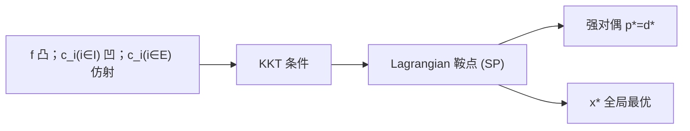

| 记号 | 含义 |
| :--- | :--- |
| $\mathcal{A}(\boldsymbol{x})$ | 活动集 $\mathcal{E}\cup\{i\in\mathcal{I}:c_i(\boldsymbol{x})=0\}$ |
| $A(\boldsymbol{x})=\nabla c(\boldsymbol{x})^T$ | 约束 Jacobian，$m\times n$，$m=\lvert\mathcal{E}\rvert+\lvert\mathcal{I}\rvert$ |
| **LICQ** | 活动约束的梯度 $\nabla c_i(\boldsymbol{x}^*),\ i\in\mathcal{A}(\boldsymbol{x}^*)$ 线性无关 |

## KKT 条件

**Karush–Kuhn–Tucker (KKT) 条件**刻画最优解 $\boldsymbol{x}^*$ 与乘子 $\boldsymbol{\lambda}^*$ 在**最优解处**必须（或足以）满足的代数关系。

在 $\boldsymbol{x}^*$ 处满足 **LICQ**（活动约束的梯度 $\nabla c_i(\boldsymbol{x}^*)$，$i\in\mathcal{A}(\boldsymbol{x}^*)$，线性无关）等约束品性时，若 $\boldsymbol{x}^*$ 为**局部最优**，则存在乘子 $\boldsymbol{\lambda}^*$ 使下列条件成立，其中 $\mathcal{L}(\boldsymbol{x},\boldsymbol{\lambda})=f(\boldsymbol{x})-\sum_i\lambda_ic_i(\boldsymbol{x})$，$\lambda_i\ge0$ 仅对 $i\in\mathcal{I}$ 要求：

$$
\boxed{
\begin{aligned}
&\text{（平稳性）}\quad
\nabla_{\boldsymbol{x}} \mathcal{L}(\boldsymbol{x}^*,\boldsymbol{\lambda}^*) = \boldsymbol{0} \\[4pt]
&\text{（原始可行性）}\quad
c_i(\boldsymbol{x}^*)=0\ (i\in\mathcal{E}),\;\; c_i(\boldsymbol{x}^*)\ge 0\ (i\in\mathcal{I}) \\[4pt]
&\text{（对偶可行性）}\quad \lambda_i^* \ge 0,\quad i\in\mathcal{I} \\[4pt]
&\text{（互补松弛）}\quad
\lambda_i^*\, c_i(\boldsymbol{x}^*) = 0,\quad i\in\mathcal{I}
\end{aligned}
}
$$

等式约束上 $c_i(\boldsymbol{x}^*)=0$，故 $\lambda_i^*c_i(\boldsymbol{x}^*)=0$ 自动成立，$\lambda_i^*$ 的符号不受限制。

一般非凸问题中，KKT 只是**必要条件**：满足 KKT 的点可能是鞍点，未必是局部最优。

## 必要性与充分性

| 方向 | 所需条件 | 结论 |
| :--- | :--- | :--- |
| **充分性** | $f$ 凸、$c_i\ (i\in\mathcal{I})$ **凹**、$c_i\ (i\in\mathcal{E})$ 仿射；$(\boldsymbol{x}^*,\boldsymbol{\lambda}^*)$ 满足 KKT | $\boldsymbol{x}^*$ 为**全局最优**（**不必** Slater） |
| **必要性** | 同上 + **Slater**；$\boldsymbol{x}^*$ 为全局最优 | 存在乘子使 KKT 成立；**强对偶** $p^*=d^*$ |

**Slater 条件**：存在严格可行的内点——$c_i(\boldsymbol{\tilde{x}})=0\ (i\in\mathcal{E})$ 且 $c_i(\boldsymbol{\tilde{x}})>0\ (i\in\mathcal{I})$，仿射不等式放宽为 $c_i(\boldsymbol{\tilde{x}})\ge 0$。它保证强对偶，从而补上「全局最优 $\Rightarrow$ 存在 KKT 乘子」这一侧（$p^*$、$d^*$ 分别为原、对偶最优值）。

凸 + Slater 时二者合并为等价：

$$
\boldsymbol{x}^* \text{ 满足 KKT} \quad \Longleftrightarrow \quad \boldsymbol{x}^* \text{ 为全局最优},
\qquad p^*=d^*.
$$

充分性的严格证明走「KKT 点 $\Rightarrow$ Lagrangian 鞍点 $\Rightarrow$ 全局最优」这条线，只用到凸性、不用 Slater；完整推导见文末附录。

## 互补松弛、影子价格与灵敏度

互补松弛 $\lambda_i^*\, c_i(\boldsymbol{x}^*) = 0$ 刻画不等式约束与乘子的分工。由 $c_i(\boldsymbol{x}^*)\ge 0$ 与 $\lambda_i^*\ge 0$，每一项 $\lambda_i^* c_i(\boldsymbol{x}^*)\ge 0$，逐项为零意味着：

| 情形 | 约束状态 | 乘子 | 含义 |
|------|---------|------|------|
| **松弛 (slack)** | $c_i(\boldsymbol{x}^*) > 0$ | $\lambda_i^* = 0$ | 约束不紧，去掉它最优解不变 |
| **活跃 (active)** | $c_i(\boldsymbol{x}^*) = 0$ | $\lambda_i^* \ge 0$ | 约束紧；$\lambda_i^*$ 为**影子价格** |

活跃约束对应 $\lambda_i^*\ge 0$，此时 $\lambda_i^*$ 称为第 $i$ 条不等式约束的**影子价格 (shadow price)**（亦称**对偶价格**）：它度量**放松该约束一单位时，最优目标值可改善的幅度**。

将约束写为 $c_i(\boldsymbol{x})\ge 0$，若将其放松为 $c_i(\boldsymbol{x})\ge -\delta$（可行域扩大），对最小化问题最优值 $p^*$ 只能下降或不变。在约束活跃且正则性良好时，一阶灵敏度为

$$
\left.\frac{\mathrm{d} p^*}{\mathrm{d}\delta}\right|_{\delta=0} = -\lambda_i^*.
$$

即 $\lambda_i^*>0$ 表示该约束**紧**地限制了解：边界向外挪一点，目标还能下降 $\lambda_i^*$ 那么多。互补松弛保证**仅活跃约束**可有 $\lambda_i^*>0$；松弛约束处 $\lambda_i^*=0$，因其放松已不改变最优值。

**与对偶问题的关系**：对偶变量 $\boldsymbol{\lambda}^*$ 正是 KKT 乘子；强对偶成立时（凸 + Slater），$\lambda_i^*$ 同时是对偶最优解的分量，故 LP 单纯形法最优表中的「对偶价格」、MILP 分支定界中的 **LP 松弛界** 都直接读取影子价格。

---

## 附录：鞍点定理证明 KKT 充分性

**定理（KKT 充分性）.** 设 $f$ 凸、各 $c_i\ (i\in\mathcal{I})$ **凹**、各 $c_i\ (i\in\mathcal{E})$ 仿射。若 $(\boldsymbol{x}^*,\boldsymbol{\lambda}^*)$ 满足 KKT，则 $\boldsymbol{x}^*$ 为原问题的**全局最优解**，且 $f(\boldsymbol{x}^*)=\mathcal{L}(\boldsymbol{x}^*,\boldsymbol{\lambda}^*)$。

证明核心：在凸性假设下，KKT 点使 Lagrangian 成为**鞍点**；鞍点右侧不等式给出对任意可行 $\boldsymbol{x}$ 的 $f(\boldsymbol{x})\ge f(\boldsymbol{x}^*)$。

### 鞍点定义与强对偶

记对偶函数 $\theta(\boldsymbol{\lambda}):=\inf_{\boldsymbol{x}}\mathcal{L}(\boldsymbol{x},\boldsymbol{\lambda})$，对偶最优值 $d^*:=\max_{\lambda_i\ge0}\theta(\boldsymbol{\lambda})$。点 $(\boldsymbol{x}^*,\boldsymbol{\lambda}^*)$（$\lambda_i^*\ge0,\ i\in\mathcal{I}$）称为 $\mathcal{L}$ 的**鞍点**，若

$$
\mathcal{L}(\boldsymbol{x}^*,\boldsymbol{\lambda})
\;\le\;
\mathcal{L}(\boldsymbol{x}^*,\boldsymbol{\lambda}^*)
\;\le\;
\mathcal{L}(\boldsymbol{x},\boldsymbol{\lambda}^*),
\qquad
\forall\,\boldsymbol{x},\;\forall\,\lambda_i\ge 0\ (i\in\mathcal{I}).
\tag{SP}
$$

**鞍点定理（约束优化版）**：若鞍点存在，则

$$
\mathcal{L}(\boldsymbol{x}^*,\boldsymbol{\lambda}^*)
= p^* = d^*,
$$

即**强对偶**成立，且 $\boldsymbol{x}^*$ 解原问题、$\boldsymbol{\lambda}^*$ 解对偶问题。理由：由 (SP) 右半，$\boldsymbol{x}^*$ 最小化 $\mathcal{L}(\cdot,\boldsymbol{\lambda}^*)$，故

$$
d^* \le \theta(\boldsymbol{\lambda}^*)
:= \inf_{\boldsymbol{x}}\mathcal{L}(\boldsymbol{x},\boldsymbol{\lambda}^*)
= \mathcal{L}(\boldsymbol{x}^*,\boldsymbol{\lambda}^*);
$$

由 (SP) 左半，对任意原可行 $\boldsymbol{x}$（$c_i=0\ (i\in\mathcal{E})$、$c_i\ge 0\ (i\in\mathcal{I})$），注意负号使可行域上 $\mathcal{L}(\boldsymbol{x},\boldsymbol{\lambda}^*)\le f(\boldsymbol{x})$，于是

$$
\mathcal{L}(\boldsymbol{x}^*,\boldsymbol{\lambda}^*)
\le \mathcal{L}(\boldsymbol{x},\boldsymbol{\lambda}^*)
\le f(\boldsymbol{x})
\quad\Longrightarrow\quad
\mathcal{L}(\boldsymbol{x}^*,\boldsymbol{\lambda}^*)\le p^*.
$$

另一方面 $\boldsymbol{x}^*$ 可行且 $\mathcal{L}(\boldsymbol{x}^*,\boldsymbol{\lambda}^*)=f(\boldsymbol{x}^*)$，故 $\mathcal{L}^*\ge p^*$。两式合并得 $\mathcal{L}^*=p^*$，再由弱对偶 $d^*\le p^*$ 得 $p^*=d^*=\mathcal{L}^*$。

因此：**证 KKT 充分性 $\Leftrightarrow$ 证 KKT 点必是鞍点**（凸情形下）。

### 第一步：KKT $\Rightarrow$ 鞍点右侧（$\boldsymbol{x}^*$ 最小化 $\mathcal{L}$）

固定 $\boldsymbol{\lambda}^*$，记

$$
\phi(\boldsymbol{x})=\mathcal{L}(\boldsymbol{x},\boldsymbol{\lambda}^*)
:= f(\boldsymbol{x})-\sum_{i\in\mathcal{E}\cup\mathcal{I}}\lambda_i^*\,c_i(\boldsymbol{x}).
$$

$f$ 凸、$c_i\ (i\in\mathcal{I})$ **凹**、$c_i\ (i\in\mathcal{E})$ 仿射 $\Rightarrow$ $\phi$ 为**凸函数**：$-\lambda_i^*c_i$ 在 $\lambda_i^*\ge0$ 且 $c_i$ 凹时是凸的，等式项 $c_i$ 仿射故 $-\lambda_i^*c_i$ 也是仿射。KKT **平稳性** $\nabla_{\boldsymbol{x}}\mathcal{L}(\boldsymbol{x}^*,\boldsymbol{\lambda}^*)=\boldsymbol{0}$ 即 $\nabla\phi(\boldsymbol{x}^*)=\boldsymbol{0}$。凸可微函数在梯度为零处取**全局极小**，故

$$
\mathcal{L}(\boldsymbol{x},\boldsymbol{\lambda}^*)
=\phi(\boldsymbol{x})
\ge \phi(\boldsymbol{x}^*)
=\mathcal{L}(\boldsymbol{x}^*,\boldsymbol{\lambda}^*),
\qquad \forall\,\boldsymbol{x}.
$$

这正是 (SP) 的**右半不等式**。

### 第二步：KKT $\Rightarrow$ 鞍点左侧（对乘子极大）

固定 $\boldsymbol{x}^*$，考察

$$
\psi(\boldsymbol{\lambda})
=\mathcal{L}(\boldsymbol{x}^*,\boldsymbol{\lambda})
:= f(\boldsymbol{x}^*)-\sum_{i\in\mathcal{E}\cup\mathcal{I}}\lambda_i\,c_i(\boldsymbol{x}^*).
$$

**等式约束**：$c_i(\boldsymbol{x}^*)=0$ 使对应项为零，与 $\lambda_i$ 无关。

**不等式部分**：记 $\Delta\lambda_i=\lambda_i-\lambda_i^*$，则

$$
\psi(\boldsymbol{\lambda})-\psi(\boldsymbol{\lambda}^*)
=-\sum_{i\in\mathcal{I}}(\lambda_i-\lambda_i^*)\,c_i(\boldsymbol{x}^*).
$$

由 **原始可行性** $c_i(\boldsymbol{x}^*)\ge 0$、**对偶可行性** $\lambda_i\ge 0$，逐项分析：

| 情形 | KKT 蕴含 | $-(\lambda_i-\lambda_i^*)c_i(\boldsymbol{x}^*)$ |
| :--- | :--- | :--- |
| $c_i(\boldsymbol{x}^*)>0$ | 互补松弛 $\lambda_i^*=0$ | $-\lambda_ic_i(\boldsymbol{x}^*)\le 0$ |
| $c_i(\boldsymbol{x}^*)=0$ | — | $0$ |
| $\lambda_i^*>0$ | 互补松弛 $c_i(\boldsymbol{x}^*)=0$ | $0$ |

故 $-\sum_i(\lambda_i-\lambda_i^*)c_i(\boldsymbol{x}^*)\le 0$，即

$$
\mathcal{L}(\boldsymbol{x}^*,\boldsymbol{\lambda})
\le
\mathcal{L}(\boldsymbol{x}^*,\boldsymbol{\lambda}^*),
\qquad \forall\,\lambda_i\ge 0\ (i\in\mathcal{I}).
$$

这是 (SP) 的**左半不等式**。等式约束在 $\boldsymbol{x}^*$ 处自动满足，$\lambda_i\ (i\in\mathcal{E})$ 方向无约束，左侧对它们自动取等。

### 第三步：由鞍点得出全局最优

由上两步，KKT 点 $(\boldsymbol{x}^*,\boldsymbol{\lambda}^*)$ 是 $\mathcal{L}$ 的鞍点，代入鞍点定理。对任意原可行 $\boldsymbol{x}$，注意 $\mathcal{L}$ 带负号，故可行域上 $\mathcal{L}(\boldsymbol{x},\boldsymbol{\lambda}^*)\le f(\boldsymbol{x})$：

$$
\mathcal{L}(\boldsymbol{x}^*,\boldsymbol{\lambda}^*)
= f(\boldsymbol{x}^*)-\underbrace{\sum_{i}\lambda_i^*c_i(\boldsymbol{x}^*)}_{=\,0}
= f(\boldsymbol{x}^*)
\le \mathcal{L}(\boldsymbol{x},\boldsymbol{\lambda}^*)
\le f(\boldsymbol{x}).
$$

其中第一个等号用 $c_i(\boldsymbol{x}^*)=0\ (i\in\mathcal{E})$ 与互补松弛 $\lambda_i^*c_i(\boldsymbol{x}^*)=0\ (i\in\mathcal{I})$；倒数第二个不等号是鞍点右半；最后一个不等号用 $-\sum_i\lambda_i^*c_i(\boldsymbol{x})\le 0$（$\lambda_i^*\ge0$、$c_i(\boldsymbol{x})\ge0$）。

故 $\boldsymbol{x}^*$ 为**全局最优**。□

### 逻辑链小结

| 步骤 | 用到的 KKT 式 | 得到的鞍点不等式 |
| :--- | :--- | :--- |
| 右半 | 平稳性 $\nabla_{\boldsymbol{x}}\mathcal{L}=0$ + $\mathcal{L}$ 对 $\boldsymbol{x}$ 凸 | $\mathcal{L}(\boldsymbol{x}^*,\boldsymbol{\lambda}^*)\le \mathcal{L}(\boldsymbol{x},\boldsymbol{\lambda}^*)$ |
| 左半 | 原始可行 + 对偶可行 + 互补松弛 | $\mathcal{L}(\boldsymbol{x}^*,\boldsymbol{\lambda})\le \mathcal{L}(\boldsymbol{x}^*,\boldsymbol{\lambda}^*)$ |

鞍点同时实现 $\min_{\boldsymbol{x}}\max_{\lambda_i\ge 0}\mathcal{L}$ 与 $\max_{\lambda_i\ge 0}\min_{\boldsymbol{x}}\mathcal{L}$ 的**换序等号**，即 minimax 定理在凸问题上的体现；KKT 则是这一鞍点的代数刻画（平稳性 + 可行性 + 互补松弛）。